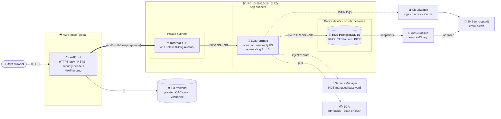
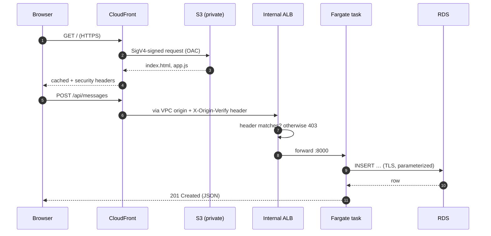
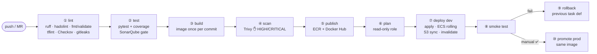

<div align="center">

# 📒 Guestbook on AWS

### A production-minded three-tier deployment: Terraform, ECS Fargate, RDS, CloudFront and a security-gated GitLab CI/CD pipeline

<br/>


<br/>

**[Architecture](#-architecture)** · **[Why these choices](#-why-i-chose-what-i-chose)** · **[Pipeline](#-cicd-pipeline)** · **[Security](#-security)** · **[Monitoring](#-monitoring--alerting)** · **[Backups](#-backups--disaster-recovery)** · **[Cost](#-cost)** · **[Production](#-how-this-changes-for-real-production)**

</div>

---

## ✨ At a glance

The application is intentionally tiny: a guestbook where you post a message and read the latest ones. That
leaves the time budget for what the assessment actually measures, **the platform around the app**:

<table>
<tr>
<td width="50%" valign="top">

#### 🏗️ Infrastructure as Code
- **8 reusable Terraform modules** + 1 composition root
- dev / prod differ **only in `tfvars`**, never in code
- Remote state in S3 with **native locking** (no DynamoDB)
- Consistent `<project>-<env>-<component>` naming, 6 mandatory tags

</td>
<td width="50%" valign="top">

#### 🔁 CI/CD
- **Lint → Test → Sonar → Build → Trivy → Push → Plan → Deploy → Smoke → Rollback → Promote**
- Image built **once**, promoted **unchanged** to prod
- **Automatic rollback** at two layers (ECS circuit breaker + pipeline)
- No cloud keys with direct permissions anywhere

</td>
</tr>
<tr>
<td valign="top">

#### 🔐 Security
- **Zero public ingress into the VPC**: CloudFront VPC origin → *internal* ALB
- Security-group chain, isolated DB subnets with **no internet route**
- KMS everywhere, TLS enforced to the DB, DB password **never seen by anyone**
- Trivy · Checkov · gitleaks · hadolint · SonarQube gates

</td>
<td valign="top">

#### 📈 Operations
- CloudWatch **dashboard as code**, **8 alarms**, log-based metric
- Autoscaling on CPU **and** request rate
- **Tested** point-in-time restore with measured RTO
- HA, WAF, DR copies and vault lock behind **one-line toggles**

</td>
</tr>
</table>

> [!NOTE]
> Built and demonstrated on an **AWS Free plan account**. Everything fits inside the free credits (~$1.70/day while
> running). The environment was **destroyed after recording the evidence**, as the brief allows. See
> [Evidence](#-evidence).

---

## ✅ Requirements coverage

How each requirement in the brief maps to this repository:

| # | Requirement | Where | Status |
|---|---|---|:---:|
| A | IaC with **compute, VPC + subnets, managed DB, naming/tagging**, not in one file | [`infra/modules/*`](infra/modules), [`infra/stack`](infra/stack), [naming](#-naming--tagging-convention) | ✅ |
| B | Dockerfile: **multi-stage, non-root, small** | [`app/backend/Dockerfile`](app/backend/Dockerfile): 2 stages, UID 10001, ~100 MB | ✅ |
| C | Pipeline **Build → Test → Image → Deploy on `main`** | [`.gitlab-ci.yml`](.gitlab-ci.yml) | ✅ |
| C | **Secrets** not hard-coded, with an explanation | [Secrets](#-secrets-how-nothing-is-hard-coded) | ✅ |
| D | Monitoring + logging + **at least one alert** | [`modules/monitoring`](infra/modules/monitoring): 8 alarms + backup events | ✅ |
| D | **Least-privilege IAM, minimal ports, encryption** | [Security](#-security) | ✅ |
| E | README: **local + cloud run, decisions, trade-offs** | this file | ✅ |
| E | **Architecture diagram** | [Architecture](#-architecture) | ✅ |
| E | **Production changes** (≤ ½ page) | [Production](#-how-this-changes-for-real-production) | ✅ |
| ➕ | *Bonus:* SonarQube, Trivy, Checkov, gitleaks, tflint, hadolint | pipeline `lint` / `test` / `scan` stages | ⭐ |
| ➕ | *Bonus:* HA/scaling toggles, WAF, autoscaling + load test | [`envs/prod`](infra/envs/prod/terraform.tfvars), [`load-test.js`](scripts/load-test.js) | ⭐ |
| ➕ | *Bonus:* AWS Backup, DR copy, vault lock, **restore drill** | [`modules/backup`](infra/modules/backup), [`restore-drill.sh`](scripts/restore-drill.sh) | ⭐ |
| ➕ | *Bonus:* smoke test + **automatic rollback**, manual prod gate | `verify` / `rollback` / `promote` stages | ⭐ |
| ➕ | *Bonus:* public image on Docker Hub | `moes98/test2026` | ⭐ |

---

## 🏛️ Architecture



<details>
<summary><b>🔎 Request lifecycle, step by step</b></summary>



</details>

### 📁 Repository layout

```text
.
├── app/
│   ├── backend/              FastAPI API · unit tests · multi-stage Dockerfile
│   └── frontend/             static HTML/JS (+ nginx Dockerfile, local only)
├── infra/
│   ├── bootstrap/            one-time: state bucket · shared ECR · CI IAM users & roles
│   ├── modules/
│   │   ├── network/          VPC · 3 subnet tiers × AZs · NAT none/single/per_az · S3 endpoint · flow logs
│   │   ├── security/         SG chain  CloudFront → ALB → app → db
│   │   ├── kms/              customer-managed key (RDS, logs, SNS, secret)
│   │   ├── database/         RDS PostgreSQL · force_ssl · managed secret
│   │   ├── compute/          ECS cluster/service/task · internal ALB · autoscaling · IAM
│   │   ├── cdn/              S3 + CloudFront (OAC, VPC origin, headers) · optional WAF
│   │   ├── monitoring/       SNS · 8 alarms · log metric · backup events · dashboard
│   │   └── backup/           AWS Backup vault + plan · DR copy · vault lock
│   ├── stack/                composition root (wires the modules for ONE environment)
│   └── envs/{dev,prod}/      terraform.tfvars + backend.hcl, values only
├── scripts/                  smoke-test.sh · restore-drill.sh · load-test.js (k6)
├── ci/aws-auth.sh            CI key → 1-hour role session
├── .gitlab-ci.yml            the pipeline
└── docker-compose.yml        the full stack locally
```

### 🏷️ Naming & tagging convention

| Rule | Example |
|---|---|
| `<project>-<env>-<component>` | `guestbook-dev-alb`, `guestbook-prod-postgres`, `guestbook-dev-api-execution` |
| Shared (account-level) resources | `guestbook-api` (ECR), `guestbook-tfstate-<account-id>`, `guestbook-ci-deploy` |
| Log groups | `/guestbook-<env>/ecs/api`, `/guestbook-<env>/vpc-flow-logs` |
| **Mandatory tags** (provider `default_tags`, so they can't be forgotten) | `Project` · `Environment` · `Owner` · `ManagedBy=terraform` · `Repository` · `CostCenter` |
| Opt-in tags | `backup=true` → included in the AWS Backup plan |

The naming isn't just cosmetic: **IAM permissions are scoped by these prefixes**. The CI deploy role can
manage `guestbook-dev-*` and `guestbook-prod-*` but can never touch `guestbook-ci-*`, its own identity.

---

## 🧠 Why I chose what I chose

Every choice below was made against the same four criteria: **security by default, low operational burden,
cost at assessment scale, and a clean path to production.**

### ☁️ Cloud provider: AWS

> **Chosen:** AWS · **Considered:** GCP (Cloud Run + Cloud SQL), Azure (Container Apps + Flexible Server)

- **Free plan credits ($200)** cover the entire exercise, including the parts that are never free elsewhere
  (load balancer, managed DB).
- The services I needed are **mature and composable**: ECS, RDS, CloudFront, AWS Backup, KMS. Notably
  **CloudFront VPC origins**, which let the API run with *no public endpoint at all*. That's the single biggest
  security win in this design and hard to match on other clouds at this price.
- It's the most common target for this kind of role, so the patterns used (IAM scoping, SG chaining, KMS key
  policies) transfer directly.
- **Honest trade-off:** GCP Cloud Run would be cheaper at idle (scales to zero and needs no load balancer). AWS
  costs about $1.70/day while running, which is irrelevant for a demo that's destroyed afterwards.

### 🐳 Compute: ECS Fargate (not EC2, EKS or Lambda)

| Option | Verdict | Reason |
|---|:---:|---|
| **ECS Fargate** | ✅ | No servers or AMIs to patch. Per-task IAM roles. Native ALB integration. Rolling deploys with a **circuit breaker that rolls back automatically**. Pay per task-second. |
| EC2 + Docker | ❌ | Mine to patch, harden and scale. Wrong use of time for a stateless API. |
| EKS | ❌ | ~$73/month control plane plus real complexity, for *one* service. Kubernetes earns its keep at 10+ services. |
| Lambda | ❌ | Cold starts, and DB connection storms without RDS Proxy. The brief asks for a container. |

### 🌐 Frontend: S3 + CloudFront (not a container)

Containerizing *everything* isn't best practice. **Use the right kind of service for each tier.** Static files
need no runtime: S3 + CloudFront gives global caching, HTTPS, compression and HTTP/3 for **cents per month**,
with nothing to patch or scale. An nginx container on Fargate would cost about $10/month and add an attack
surface for no benefit. (nginx *is* used locally in `docker compose`, standing in for CloudFront.)

### 🐘 Database: managed RDS PostgreSQL (not Postgres in a container)

Running a stateful database in a container in production means owning **backups, PITR, failover, patching,
storage and encryption** yourself. RDS gives all of that, plus Multi-AZ with one variable. PostgreSQL because
it's the safest default for relational data. `db.t4g.micro` (Graviton) because it's free-tier eligible.

### 🔐 Edge: CloudFront **VPC origin** → **internal** ALB

<details>
<summary><b>Why this matters (click)</b></summary>

The usual pattern is a *public* ALB "restricted" to CloudFront's IP prefix list. It's still internet-addressable,
and anyone who learns its DNS name can probe it.

With a **VPC origin**, CloudFront connects to an **internal** ALB over AWS's private network:

- The ALB has **no public IP and no public DNS resolution**. There's nothing to scan.
- A second layer: CloudFront adds a secret `X-Origin-Verify` header (generated by Terraform). The ALB's default
  action is **403**, and only requests carrying the header are forwarded.
- **One domain** serves both the frontend and `/api/*`, so there's **no CORS** configuration to get wrong.

</details>

### 🧩 IaC structure: one root stack + per-environment `tfvars`

> **Chosen:** `infra/stack` + `envs/{dev,prod}/terraform.tfvars` · **Considered:** a copied `main.tf` per env, Terragrunt, workspaces

- **dev and prod can't drift in code.** They differ only in *values*: `nat_gateway_mode`, `db_multi_az`,
  `enable_waf`, `min_tasks` and so on. Reviewing a prod change means reading a `tfvars` diff.
- Workspaces hide which environment you're in, which is a classic way to apply to prod by accident. Separate
  state keys plus explicit `-var-file` are visible and greppable.
- Terragrunt would solve the same problem but adds another tool. Plain Terraform was enough here.
- **State:** S3 with **`use_lockfile = true`** (S3-native locking, Terraform ≥ 1.10). There's no DynamoDB table,
  which is now the recommended approach. The bucket is versioned, KMS-encrypted and TLS-only.

### 🔁 CI/CD: GitLab CI on a self-hosted instance

- I run self-hosted **GitLab CE + SonarQube** day to day, so the pipeline uses the real toolchain, including a
  **SonarQube quality gate**, not just a demo linter.
- **Build once, promote the same image.** The image that passed tests and Trivy in dev is byte-for-byte what
  reaches prod. ECR tags are **immutable**, so a tag can never be silently overwritten.
- **Scan before push.** Trivy runs on the image *tarball* before it reaches any registry, so a vulnerable image
  is never published. It caught real issues during development: **3 HIGH CVEs in Starlette**, fixed by
  bumping dependencies.
- **Two registries.** ECR is what deploys use: private, controlled by IAM, close to the compute. **Docker Hub**
  (`moes98/test2026`) is a public showcase, so reviewers can `docker run` the image.

### 💸 No NAT gateway in dev

The NAT gateway is the usual hidden cost on AWS (~$35/month per AZ). In dev, tasks sit in public subnets with a
public IP used **for egress only**. Their security group still admits traffic from the ALB alone, so nothing
from the internet can reach them. Prod uses `nat_gateway_mode = "per_az"`, which puts tasks in private subnets
with no public IP. **Same code, one variable.**

---

## 🔁 CI/CD pipeline



| Stage | Jobs | Runs on | Gate |
|---|---|---|---|
| **lint** | `lint:python` · `lint:dockerfile` · `lint:terraform` · `lint:tflint` · `security:checkov` · `security:gitleaks` | MR + main | any failure stops the pipeline |
| **test** | `test:unit` (JUnit + Cobertura shown in GitLab) · `sonarqube` (waits for the quality gate) | MR + main | failed test / gate |
| **build** | `build:image`: labelled with the commit SHA, saved as an artefact | MR + main | |
| **scan** | `scan:trivy`: GitLab container-scanning report + hard gate | MR + main | fixable HIGH/CRITICAL |
| **publish** | `publish:image`: ECR (immutable) + Docker Hub `:sha` and `:latest` | main | |
| **plan** | `plan:dev`: read-only role, plan summary widget in the MR | MR + main | |
| **deploy** | `deploy:dev`: apply the saved plan, wait for ECS steady state, sync the frontend, invalidate CloudFront | main | ECS circuit breaker |
| **verify** | `smoke:dev`: HTTPS, HTTP→HTTPS redirect, **deployed version = commit**, DB readiness, write/read round trip | main | |
| **rollback** | `rollback:dev`: reverts ECS to the task definition recorded *before* deploy | main, **on failure** | |
| **promote** | `deploy:prod`: same image, prod `tfvars`, **manual** | main | human approval |

**Two layers of rollback:**
1. **ECS deployment circuit breaker:** if new tasks fail their health checks, ECS reverts to the last steady
   state by itself, without the pipeline.
2. **Pipeline rollback job:** if tasks are healthy but the *smoke test* fails (wrong behaviour, not a crash),
   the job restores the previous task definition.

`resource_group`s serialize deploys per environment, so two pipelines can never apply at the same time.

---

## 🔒 Security

| Layer | What's in place |
|---|---|
| 🌐 **Network** | 3 subnet tiers. **DB subnets have no route to the internet.** SGs reference each other by ID, never CIDR: CloudFront prefix list → ALB:80 → app:8000 → db:5432. The DB SG has **no egress**. The default SG is stripped of all rules. **VPC flow logs** record rejected traffic. |
| 🚪 **Ports** | Internet-facing: **CloudFront 443 only** (80 → 301). Nothing inside the VPC has a public listener. |
| 👤 **IAM** | **Execution role:** pull image, write logs, read **one** secret, decrypt with **one** key. **Task role:** **no permissions at all** (the app calls no AWS APIs). CI: [below](#-secrets-how-nothing-is-hard-coded). |
| 🔑 **Encryption at rest** | Customer-managed **KMS key with rotation** for RDS, its secret, log groups and SNS. A **separate key** for backups, so a compromise of one doesn't expose the other. S3 and ECR encrypted. |
| 🔐 **In transit** | CloudFront HTTPS + HSTS. **`rds.force_ssl=1`**, so the DB *rejects* non-TLS clients. The app uses `sslmode=require`. Bucket policies **deny non-TLS** requests. |
| 🐳 **Container** | Alpine multi-stage, **no pip or setuptools at runtime**, numeric UID **10001**, **read-only root filesystem**, **all capabilities dropped**, healthcheck. |
| 🧑‍💻 **App** | Pydantic length validation, parameterized SQL, `textContent` rendering (no XSS), managed security-headers policy, **WAF** (common rules + known bad inputs/Log4j + per-IP rate limit) in prod. |
| 📦 **Supply chain** | Trivy gate before push · ECR scan on push · Checkov (**279 passed, 0 failed**; every exception justified in [`.checkov.yaml`](infra/.checkov.yaml)) · gitleaks over the **full history** · hadolint · tflint. |

### 🗝️ Secrets: how nothing is hard-coded

| Secret | Where it lives | Who can read it |
|---|---|---|
| **DB password** | Generated by RDS (`manage_master_user_password`), in Secrets Manager under our KMS key, **rotated by AWS** | Only the ECS execution role, which injects it at container start. **No human or CI job ever sees it**, and it's never in Terraform state. |
| **CloudFront → ALB header** | `random_password` in Terraform | Encrypted, versioned state bucket |
| **CI cloud credentials** | GitLab masked variables (deploy key also **protected**) | See below |
| **Docker Hub / SonarQube tokens** | GitLab masked (+ protected) variables | Pipeline jobs only |

<details open>
<summary><b>Why CI uses assume-role keys instead of OIDC, and how that's made safe</b></summary>

The ideal is **keyless OIDC federation** (GitLab or GitHub issues a short-lived JWT and AWS trusts it). It needs
AWS to fetch the GitLab instance's public signing keys, and **this GitLab is on a private network**, so AWS can't
reach it. That's a real-world constraint, not a shortcut. The next-best design:

```text
 GitLab variable (masked)        IAM user                     IAM role (1 h session)
 AWS_PLAN_*   ───────────▶  guestbook-ci-plan   ──AssumeRole──▶  guestbook-ci-plan    ReadOnlyAccess + state
 AWS_DEPLOY_* (protected) ▶ guestbook-ci-deploy ──AssumeRole──▶  guestbook-ci-deploy  scoped deploy policy
```

- The users have **exactly one permission**: `sts:AssumeRole` on their own role. A leaked key alone can't touch
  any resource, and every use is an STS call recorded in CloudTrail.
- The **deploy key is a *protected* variable**, so GitLab only gives it to pipelines on the protected `main`
  branch. **A merge request can never deploy**, even if someone edits `.gitlab-ci.yml` in a branch.
- The deploy role is scoped by **service list**, **region** (`aws:RequestedRegion`), **name prefix** for S3, ECR
  and IAM, and **`iam:PassRole` only to named services**, with an explicit **deny on editing the CI identities**
  (no privilege escalation).
- Keys are created **outside Terraform**, so no secret ever lands in state.
- With gitlab.com or GitHub Actions, this becomes an OIDC trust policy pinned to
  `project_path:<repo>:ref_type:branch:ref:main`, and the users disappear.

</details>

---

## 📊 Monitoring & alerting

- **Logs:** structured **JSON** to stdout → `/guestbook-<env>/ecs/api` (KMS-encrypted, with retention). RDS
  Postgres logs exported. VPC flow logs.
- **Dashboard as code** (`guestbook-<env>-overview`): traffic, 5xx, p50/p95 latency, healthy tasks, ECS CPU and
  memory, app errors, RDS CPU and connections, live alarm status, and a Logs Insights table of recent errors.
- **Alerts** → encrypted SNS topic → email:

| 🚨 Alarm | Fires when | Why it matters |
|---|---|---|
| `api-no-healthy-targets` | healthy tasks < 1 for 2 min *(missing data = breaching)* | **The API is down** |
| `api-5xx` | ≥ 5 target 5xx in 5 min | Users are seeing errors |
| `api-latency-p95` | p95 > 1 s in 3 of 5 min | Slow before broken |
| `api-error-logs` | ≥ 5 `level=ERROR` lines in 5 min | **Log-based metric filter**, catches handled exceptions that never become 5xx |
| `ecs-cpu-high` / `ecs-memory-high` | > 80 % for 10 min | Autoscaling has probably hit its maximum |
| `rds-cpu-high` | > 80 % for 15 min | DB saturation |
| `rds-free-storage-low` | < 2 GB | Prevents a full disk taking the DB down |
| *Backup job failed* | EventBridge: AWS Backup `FAILED` / `ABORTED` / `EXPIRED` | Silent backup failure is the worst kind |

---

## ⚖️ Scalability & high availability

Implemented, not just described. **Flip the toggles in [`envs/prod/terraform.tfvars`](infra/envs/prod/terraform.tfvars):**

| Capability | dev | prod |
|---|---|---|
| Availability zones | 2 | **3** |
| API tasks (autoscaling) | 1 → 3 on CPU 60 % **or** 500 req/task/min | **2 → 10**, at least one per AZ |
| Task placement | public subnets, no NAT | **private subnets, NAT per AZ** |
| Database | single-AZ `db.t4g.micro` | **Multi-AZ** `db.t4g.medium` · storage autoscaling · Performance Insights · deletion protection · final snapshot |
| Edge protection | CloudFront | CloudFront + **WAF** |
| Container Insights | off | **on** |
| Deploy strategy | rolling, 100 % min healthy, circuit breaker | same + **manual approval** |

`scripts/load-test.js` (k6) ramps to 60 virtual users to show the request-rate policy scaling the service out.

---

## 🛟 Backups & disaster recovery

| Layer | Mechanism |
|---|---|
| **RDS** | Automated backups with **point-in-time recovery** (prod 14 days · dev 1 day, the maximum the AWS Free plan allows) |
| **AWS Backup** | Dedicated vault with its **own KMS key**. Daily (7 / 14 days) and weekly (prod: 90 days) rules. Selection by `backup=true` + matching `Environment`. |
| **DR** *(prod)* | Every recovery point **copied to `eu-central-1`** |
| **Ransomware** *(prod)* | **Vault lock (compliance mode)**: no early deletion, *not even by an admin* |
| **Frontend / state** | S3 **versioning**: instant rollback of a bad frontend deploy, recovery of Terraform state |
| **Alerting** | Backup or copy job failure → email |

> [!TIP]
> **A backup you haven't restored isn't a backup.** `scripts/restore-drill.sh dev <url>` proves it:
>
> 1. writes **marker A**, records time **T**, writes **marker B**
> 2. restores the DB **to time T as a new instance** (production untouched)
> 3. queries the copy **from inside the VPC** with a one-off ECS task
> 4. **PASS = A present, B absent**: the restore landed on the exact second requested
> 5. prints the **measured RTO** and deletes the copy
>
> Targets: **RPO ≈ 5 min** (transaction-log shipping) · **RTO ≈ 15–20 min** (measured).

---

## 💰 Cost

dev in `eu-north-1`, running 24/7. *Estimates.* The demo ran for a few hours.

| Item | ≈ USD / month |
|---|---:|
| Internal ALB | 18.0 |
| Fargate 0.25 vCPU / 0.5 GB × 1 | 10.0 |
| RDS `db.t4g.micro` + 20 GB gp3 *(free-tier eligible)* | 14.0 |
| KMS keys × 2 | 2.0 |
| Public IPv4 (task) | 3.6 |
| CloudFront · S3 · CloudWatch · SNS · Secrets Manager · Backup | ~2.0 |
| **Total** | **≈ 50 → ≈ $1.70 / day**, covered by Free plan credits |

**Biggest saving:** no NAT gateway in dev (−$35/month). **Biggest prod cost drivers:** NAT per AZ, Multi-AZ RDS,
WAF. All three are behind toggles.

---

## 🚀 Running it

### 💻 Locally (one command)

```bash
docker compose up --build          # postgres + api + nginx (stands in for CloudFront)
open http://localhost:8080         # or: curl localhost:8080/api/ready
```

The API container runs **read-only** with `no-new-privileges`, exactly as in ECS.

<details>
<summary>Tests & lint (same commands as CI)</summary>

```bash
cd app/backend
pip install -r requirements-dev.txt
ruff check . && ruff format --check .
pytest --cov
```

</details>

### ☁️ In AWS

**Requirements:** Terraform ≥ 1.10, AWS CLI v2, admin credentials (bootstrap only).

```bash
# 1 · one-time bootstrap: state bucket, ECR, CI identities
cd infra/bootstrap && terraform init && terraform apply

# 2 · CI keys (outside Terraform, so no secret in state) → GitLab CI/CD variables
aws iam create-access-key --user-name guestbook-ci-plan     # AWS_PLAN_*    masked
aws iam create-access-key --user-name guestbook-ci-deploy   # AWS_DEPLOY_*  masked + protected
#    + AWS_ACCOUNT_ID, ALERT_EMAIL, DOCKERHUB_TOKEN · protect the main branch

# 3 · push to main → the pipeline builds, scans, deploys and smoke-tests (~15 min first run)
```

<details>
<summary>Manual deploy without CI / teardown</summary>

```bash
cd infra/stack
terraform init -backend-config=../envs/dev/backend.hcl \
               -backend-config="bucket=guestbook-tfstate-<ACCOUNT_ID>"
terraform apply -var-file=../envs/dev/terraform.tfvars \
                -var image_tag=<tag> -var 'alert_emails=["you@example.com"]'

# teardown
terraform destroy -var-file=../envs/dev/terraform.tfvars -var image_tag=<tag>
cd ../bootstrap && terraform destroy
```

</details>

---

## ⏱️ Trade-offs made for the time limit

| Shortcut | Why | Production answer |
|---|---|---|
| No custom domain | None owned for the exercise | Route 53 + ACM: HTTPS to the origin too, TLS 1.2+ minimum on viewers |
| App uses the RDS master user | Saves a migration/user-provisioning step | Least-privilege app role via migration job, or IAM DB auth (already enabled) |
| Migrations at app start-up | Idempotent + advisory lock is safe at this scale | Alembic as a separate pre-deploy ECS task |
| Deploy role is *scoped*, not *minimal* | Exact action lists take iterations | IAM Access Analyzer policy generation from CloudTrail |
| Access logs and WAF logs off | Avoids a log bucket and its cost | Central log-archive account |
| dev PITR window is 1 day | The AWS Free plan rejects longer RDS backup retention (`FreeTierRestrictionError`) | 14 days in prod, plus AWS Backup daily and weekly copies |
| prod defined but not left running | Cost | Same code, `envs/prod/terraform.tfvars` |

---

## 🏭 How this changes for real production

**Scale.** Private subnets behind NAT per AZ, as `envs/prod` already does. Autoscaling floors of one task per AZ
and ceilings set from load tests. **RDS Proxy** for connection pooling, plus **read replicas** or **Aurora
Serverless v2** when reads dominate. Short-TTL caching of `GET`s at CloudFront, and a CI-built SPA with hashed
assets and long cache lifetimes.

**High availability.** Multi-AZ RDS (~60 s failover) and tasks across 3 AZs survive the loss of a zone. For a
region: **Aurora Global Database**, ECR replication, and a CloudFront origin group or Route 53 failover to a warm
standby (backups are already copied cross-region). SLOs (99.9 %, p95 < 300 ms) with **burn-rate alerts** to
on-call instead of email, and the restore drill **on a schedule**.

**Cost.** Compute **Savings Plans** for Fargate (up to 50 %) and **reserved** RDS for the baseline. **Graviton**
tasks (~20 % cheaper) with multi-arch builds. **Fargate Spot** for workers. Interface endpoints once NAT data
charges exceed their fixed cost. **Budgets + Cost Anomaly Detection** by `CostCenter`. Non-prod scaled to zero
out of hours.

**Governance.** AWS Organizations (separate dev and prod accounts, SCPs), IAM Identity Center for people, **OIDC**
for CI, GuardDuty, Security Hub, an organization CloudTrail trail and AWS Config.

---

## 📸 Evidence

Screenshots are in [`docs/evidence/`](docs/evidence/). The deployment was destroyed afterwards, as permitted.

| # | Shows | # | Shows |
|:-:|---|:-:|---|
| 01 | Full pipeline green on `main` | 08 | CloudWatch dashboard |
| 02 | Unit tests and coverage in GitLab | 09 | Alarm firing + email received |
| 03 | SonarQube quality gate | 10 | Autoscaling under k6 load |
| 04 | Trivy: no fixable HIGH/CRITICAL | 11 | Restore drill **PASS** + RTO |
| 05 | `terraform apply` | 12 | Image on Docker Hub |
| 06 | App working through CloudFront | 13 | `terraform destroy` |
| 07 | ECS · internal ALB · private RDS · secret | | |

<div align="center">
<br/>
<sub>Built by <b>Mohamed Samir</b> · Cloud / DevOps Engineer assessment</sub>
</div>
