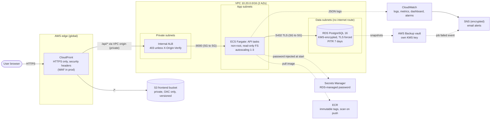
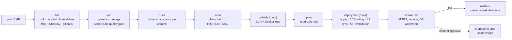

# Guestbook — three-tier app on AWS, fully automated

A deliberately small app (static frontend → REST API → PostgreSQL). The point
of the project is everything around it: **Terraform modules, a hardened
container, a GitLab CI/CD pipeline with security gates and automatic rollback,
least-privilege IAM, monitoring, alerting and tested backups.**

| | |
|---|---|
| **Cloud** | AWS, `eu-north-1` (Stockholm) |
| **IaC** | Terraform 1.16, 8 reusable modules, one root stack, per-environment `tfvars` |
| **Compute** | ECS Fargate behind an *internal* ALB |
| **Data** | RDS PostgreSQL 16 (encrypted, private, TLS enforced) + AWS Backup |
| **Edge** | CloudFront: S3 for static files, a **VPC origin** for `/api/*` |
| **CI/CD** | GitLab CI with SonarQube, Trivy, Checkov, tflint, gitleaks and hadolint |
| **Account** | AWS **Free plan** account; everything is covered by the free credits (see [Cost](#cost)) |

---

## Architecture



**CI/CD flow**



Request path: the browser only talks to CloudFront. `/*` is served from a
**private** S3 bucket through Origin Access Control. `/api/*` goes to an
**internal** load balancer through a CloudFront **VPC origin**. Nothing in the
VPC accepts connections from the internet.

---

## Repository layout

```
app/
  backend/            FastAPI API, unit tests, multi-stage Dockerfile
  frontend/           static HTML/JS (+ nginx Dockerfile for local use only)
infra/
  bootstrap/          one-time: state bucket, shared ECR repo, CI IAM users/roles
  modules/
    network/          VPC, 3 subnet tiers x AZs, optional NAT (none/single/per_az), S3 endpoint, flow logs
    security/         security-group chain: CloudFront -> ALB -> app -> db
    kms/              customer-managed key for RDS, logs, SNS, secrets
    database/         RDS PostgreSQL, parameter group (force_ssl), managed secret
    compute/          ECS cluster/service/task, internal ALB, autoscaling, IAM roles
    cdn/              S3 + CloudFront (OAC, VPC origin, security headers) + optional WAF
    monitoring/       SNS, 8 alarms, log metric filter, backup-failure events, dashboard
    backup/           AWS Backup vault + plan, optional cross-region copy and vault lock
  stack/              composition root: wires the modules for one environment
  envs/dev|prod/      terraform.tfvars + backend.hcl: environments differ ONLY in values
scripts/              smoke-test.sh, restore-drill.sh, load-test.js (k6)
ci/aws-auth.sh        turns a CI key into a 1-hour role session
.gitlab-ci.yml        pipeline
docker-compose.yml    full stack locally
```

### Naming and tagging convention

* Names are `<project>-<env>-<component>`, e.g. `guestbook-dev-alb` or `guestbook-prod-postgres`.
  The shared layer uses `guestbook-<component>` (`guestbook-api`, `guestbook-tfstate-<account>`).
* Every resource gets these tags through the provider's `default_tags`:
  `Project`, `Environment`, `Owner`, `ManagedBy=terraform`, `Repository`, `CostCenter`.
  Resources can't be created untagged, and costs can be split by environment in Cost Explorer.
* `backup=true` opts a resource into the AWS Backup plan.

---

## Running locally

Requirements: Docker with Compose v2.

```bash
docker compose up --build        # db + api + frontend
open http://localhost:8080       # or: curl localhost:8080/api/ready
```

Nginx in front plays the role of CloudFront (`/` serves static files, `/api/` goes to the API). The API
container runs with a read-only filesystem and `no-new-privileges`, as it does in ECS.

Tests and lint, using the same commands as CI:

```bash
cd app/backend
pip install -r requirements-dev.txt
ruff check . && ruff format --check .
pytest --cov
```

---

## Deploying to AWS

Requirements: Terraform ≥ 1.10, AWS CLI v2, admin credentials for the one-time bootstrap.

**1. Bootstrap (once per account).** Creates the state bucket, ECR and the CI identities.

```bash
cd infra/bootstrap
terraform init && terraform apply
```

**2. Create the CI keys and store them in GitLab.** They're created outside Terraform, so no secret ever lands in state.

```bash
aws iam create-access-key --user-name guestbook-ci-plan     # -> AWS_PLAN_*   (masked)
aws iam create-access-key --user-name guestbook-ci-deploy   # -> AWS_DEPLOY_* (masked + protected)
```

Add `AWS_ACCOUNT_ID`, `ALERT_EMAIL` and optionally `DOCKERHUB_TOKEN` (see the header of `.gitlab-ci.yml`).
Protect the `main` branch.

**3. Push to `main`.** The pipeline builds, scans, pushes and deploys. The first run creates the whole
environment, which takes about 15 minutes because of RDS and CloudFront.

**Manual deploy (no CI):**

```bash
cd infra/stack
terraform init -backend-config=../envs/dev/backend.hcl -backend-config="bucket=guestbook-tfstate-<ACCOUNT_ID>"
terraform apply -var-file=../envs/dev/terraform.tfvars -var image_tag=<tag> -var 'alert_emails=["you@example.com"]'
```

**Tear down:** `terraform destroy` with the same arguments, then destroy `infra/bootstrap`.

---

## Key decisions and rationale

| Decision | Why | Alternatives considered |
|---|---|---|
| **AWS** | Free plan credits ($200) cover the whole exercise. ECS, RDS and CloudFront are mature, well-documented managed services. | GCP Cloud Run + Cloud SQL is equally good and cheaper at idle; Azure Container Apps. |
| **ECS Fargate** for the API | No servers or AMIs to patch, per-task IAM roles, native ALB integration, rolling deploys with a circuit breaker. | EC2 (patching burden); EKS (control-plane cost and complexity for one service); Lambda (cold starts, DB connection pooling). |
| **S3 + CloudFront** for the frontend, not a container | Static files need no runtime: global caching, near-zero cost, no scaling or patching. | An nginx container on Fargate costs about $10/month for no benefit. |
| **Managed RDS**, not Postgres in a container | Backups, PITR, Multi-AZ failover, patching and encryption come built in. | Self-managing a stateful container in production is risky. |
| **CloudFront VPC origin + internal ALB** | The API has **no public entry point**. One domain for both static files and the API, so no CORS. The ALB also checks a secret `X-Origin-Verify` header as a second layer. | A public ALB restricted to the CloudFront prefix list (still internet-addressable). |
| **One root stack + per-env `tfvars`** | dev and prod can't drift in code; they differ only in values (`nat_gateway_mode`, `db_multi_az`, `enable_waf` …). | A copied `main.tf` per environment (drift-prone); Terragrunt (another tool to learn). |
| **S3 native state locking** (`use_lockfile`) | Terraform ≥ 1.10 locks state in S3 itself, so no DynamoDB table is needed. | A DynamoDB lock table (deprecated pattern). |
| **Build once, promote the same image** | The image that passed tests and the Trivy scan in dev is byte-for-byte what reaches prod. ECR tags are immutable. | Rebuilding per environment (can differ, and the scans don't carry over). |

---

## Security

| Area | Implementation |
|---|---|
| **Network** | 3 subnet tiers. The DB subnets have **no route to the internet**. SGs reference each other by ID: CloudFront prefix list → ALB:80 → app:8000 → db:5432. The DB SG has no egress. The default SG is stripped of all rules. VPC flow logs record rejected traffic. |
| **Ports** | Internet-facing: only CloudFront 443 (80 redirects). Nothing in the VPC has a public listener. |
| **IAM** | ECS **execution role**: pull image, write logs, read *one* secret, decrypt with *one* key. **Task role**: no permissions at all (the app needs no AWS APIs). CI roles: see below. |
| **Encryption at rest** | Customer-managed KMS key with rotation for RDS storage, the RDS secret, CloudWatch log groups and SNS. A **separate** key for the backup vault. S3 buckets encrypted. ECR encrypted with KMS. |
| **Encryption in transit** | HTTPS enforced at CloudFront with HSTS. `rds.force_ssl=1` rejects non-TLS DB clients, and the app connects with `sslmode=require`. S3 bucket policies deny non-TLS requests. |
| **Container** | Multi-stage Alpine build at about 100 MB, no pip or setuptools in the runtime layer, numeric non-root UID 10001, read-only root filesystem, all Linux capabilities dropped, healthcheck. |
| **App** | Input validation (pydantic length limits), parameterized SQL, frontend renders with `textContent` (no XSS), security headers via the CloudFront managed policy, WAF (common + known-bad-inputs + rate limit) in prod. |
| **Supply chain** | Trivy blocks fixable HIGH/CRITICAL CVEs **before** push. During development it caught 3 HIGH Starlette CVEs, which were fixed by bumping versions. ECR scan on push. Checkov on all Terraform (279 checks pass; every skip is justified in `infra/.checkov.yaml`). gitleaks scans the full history. |

### Secrets, and why nothing is hard-coded

* **DB password:** generated by RDS (`manage_master_user_password`), stored in Secrets Manager under our KMS key and
  rotated by AWS. ECS injects it into the container at start (`secrets` → `valueFrom`). It is never in code,
  the image, CI variables, logs or Terraform state.
* **CloudFront→ALB header secret:** generated by Terraform (`random_password`). It lives only in the encrypted,
  versioned state bucket.
* **CI cloud credentials:** this GitLab instance is on a private network, so AWS can't reach its OIDC discovery
  endpoint, and keyless OIDC federation (the preferred option, which I'd use with gitlab.com or GitHub Actions)
  isn't possible. The next-best design:
  * **Two IAM users** whose **only** permission is `sts:AssumeRole` on **one** role each, which gives 1-hour sessions
    (`ci/aws-auth.sh`). A leaked key alone can't touch resources without STS calls that show up in CloudTrail.
  * The **plan** key is a masked variable available to merge requests. Its role is `ReadOnlyAccess` plus the state
    bucket.
  * The **deploy** key is **masked + protected**, so GitLab only exposes it to pipelines on the protected `main`
    branch. An MR from a feature branch can never deploy.
  * The deploy role is scoped by **service list, region (`aws:RequestedRegion`), resource name prefix** for S3,
    ECR and IAM (`guestbook-dev-*` / `guestbook-prod-*`), `iam:PassRole` only to specific services, and an explicit
    **deny** on modifying the CI identities themselves.
* **Docker Hub / SonarQube tokens:** masked GitLab variables; Docker Hub is also protected.
* **Repository:** gitleaks runs on every pipeline over the full git history.

---

## Monitoring and logging

* **Logs:** the API writes structured **JSON** to stdout. ECS awslogs sends it to `/guestbook-<env>/ecs/api`
  (KMS-encrypted, with retention). RDS Postgres logs are exported to CloudWatch. VPC flow logs capture rejected
  traffic.
* **Dashboard** (`guestbook-<env>-overview`, defined in Terraform): requests, 5xx, p50/p95 latency, healthy
  tasks, ECS CPU and memory, app error count, RDS CPU and connections, alarm status, and a Logs Insights table
  of recent errors.
* **Alarms**, all sent to an encrypted SNS topic with email subscribers:

| Alarm | Condition |
|---|---|
| `api-5xx` | ≥ 5 target 5xx responses in 5 min |
| `api-latency-p95` | p95 > 1 s in 3 of 5 minutes |
| `api-no-healthy-targets` | healthy tasks < 1 for 2 min (**API down**; missing data counts as breaching) |
| `api-error-logs` | ≥ 5 `level=ERROR` log lines in 5 min (**log-based metric filter**) |
| `ecs-cpu-high` / `ecs-memory-high` | > 80 % for 10 min (autoscaling has probably hit its maximum) |
| `rds-cpu-high` | > 80 % for 15 min |
| `rds-free-storage-low` | < 2 GB |
| Backup job failed | EventBridge rule on AWS Backup `FAILED` / `ABORTED` / `EXPIRED` |

---

## Scalability and high availability (implemented, toggled per environment)

| | dev | prod (`envs/prod/terraform.tfvars`) |
|---|---|---|
| AZs | 2 | 3 |
| API tasks | 1–3, scaling on CPU 60 % or 500 req/task/min | 2–10, one per AZ minimum |
| Task placement | public subnets, no NAT (cost) | private subnets, **one NAT per AZ** |
| RDS | single-AZ `db.t4g.micro` | **Multi-AZ** `db.t4g.medium`, storage autoscaling, Performance Insights, deletion protection, final snapshot |
| Edge | CloudFront | CloudFront + **WAF** |
| Deploys | rolling, 100 % min healthy, circuit-breaker rollback | same, plus a manual approval gate |

Autoscaling can be shown with `scripts/load-test.js` (k6), which ramps to 60 virtual users and pushes the
request-per-target policy into scaling out.

## Backups and disaster recovery

| Layer | Mechanism |
|---|---|
| RDS | Automated backups with **point-in-time recovery** (7 days dev / 14 prod), copy tags to snapshots |
| AWS Backup | Vault with its **own KMS key**. Daily rule (7 / 14 days), weekly rule (prod: 90 days). Selection by `backup=true` + `Environment` tag. |
| DR (prod) | Every recovery point is **copied to `eu-central-1`** |
| Ransomware (prod) | **Vault lock** in compliance mode: recovery points can't be deleted early, not even by an admin |
| Frontend / state | S3 versioning (instant rollback of a bad frontend deploy, recovery of state) |
| Alerting | Backup or copy job failure → SNS email |

**Restore drill:** `scripts/restore-drill.sh dev <app-url>` writes marker A, records time *T*, writes marker B,
restores the database **to time T as a new instance**, then queries the copy from inside the VPC with a
one-off ECS task. Pass means A is present and B is absent, so the restore lands at exactly the requested second.
It prints the measured RTO and deletes the copy. Targets: **RPO ≈ 5 min** (transaction-log shipping interval),
**RTO ≈ 15–20 min** (measured by the drill; see evidence).

---

## Cost

dev, running continuously in `eu-north-1`. Estimates; the demo runs for a few hours, then is destroyed.

| Item | ~USD/month |
|---|---|
| ALB (internal) | 18 |
| Fargate 0.25 vCPU / 0.5 GB × 1 | 10 |
| RDS `db.t4g.micro` + 20 GB gp3 | 14 (free-tier eligible) |
| KMS keys (2) | 2 |
| Public IPv4 for the task | 3.6 |
| CloudFront, S3, CloudWatch, SNS, Secrets Manager, Backup | ~2 |
| **Total** | **≈ 50/month ≈ $1.70/day**, all covered by the Free plan credits |

The biggest saving: **no NAT gateway in dev** (−$35/month), because tasks use public IPs for egress only, and
their SG still accepts traffic from the ALB alone. Prod pays for NAT per AZ so tasks get no public IP.

---

## Trade-offs made for the time limit

* **No custom domain**, so CloudFront uses its default certificate, and CloudFront→ALB is HTTP inside AWS's
  private network (VPC origin). With a domain: ACM certificates, HTTPS to the origin, TLS 1.2+ minimum on the
  viewer side.
* **The app uses the RDS master user.** In production: a least-privilege application role created by a migration
  job, or IAM database authentication (already enabled on the instance).
* **Schema migration runs at app start-up** (idempotent, serialized by a Postgres advisory lock). In production:
  Alembic migrations as a separate pre-deploy ECS task.
* **The CI deploy role is scoped, not minimal.** It's limited by service, region and name prefix. The next step
  is IAM Access Analyzer policy generation from CloudTrail activity to cut it down to exactly the calls used.
* **Access logs** (CloudFront, ALB, S3) and **WAF logging** are off to avoid a log bucket and its cost. They're
  listed in the Checkov exceptions.
* **prod is fully defined but was not left running.** Only dev was deployed for the evidence below.

---

## How this changes for real production (scale · cost · HA)

**Scale.** Run the API in private subnets behind NAT per AZ, as `envs/prod` already does. Scale tasks on
request rate and CPU between a floor of one task per AZ and a ceiling sized from load tests. Add **RDS Proxy**
for connection pooling, and **read replicas** or Aurora PostgreSQL Serverless v2 when reads dominate. Cache
`GET` responses at CloudFront with short TTLs. Move the frontend to a CI-built SPA with hashed filenames and
long cache headers.

**High availability.** Multi-AZ RDS (synchronous standby, about 60 s failover) and tasks spread across 3 AZs
handle the loss of a zone. For regional failure: Aurora Global Database or cross-region read replicas, ECR
replication, and a CloudFront origin group or Route 53 failover to a warm standby region. Backups are already
copied cross-region. Define SLOs (e.g. 99.9 % availability, p95 < 300 ms) with burn-rate alerts going to
PagerDuty instead of email, and run the restore drill on a schedule.

**Cost.** Use Compute Savings Plans for Fargate (up to 50 % off) and RDS reserved instances for the steady
baseline. Run Fargate Spot for non-critical or worker tasks. Use Graviton (`ARM64`) tasks, about 20 % cheaper,
with multi-arch builds. Add VPC interface endpoints once NAT data-processing costs exceed their fixed cost.
Add AWS Budgets and Cost Anomaly Detection per `CostCenter` tag, and schedule non-prod environments to scale to
zero outside working hours.

**Operations and security.** AWS Organizations with separate dev and prod accounts, SCP guardrails, IAM
Identity Center for humans, OIDC for CI (with a public GitLab or GitHub), GuardDuty, Security Hub, CloudTrail
organization trail, AWS Config rules, and access and WAF logs centralized in a log-archive account.

---

## Evidence

Screenshots are in [`docs/evidence/`](docs/evidence/). The deployment was destroyed after recording, as the
brief allows.

| # | What it shows |
|---|---|
| 01 | Full pipeline green on `main` (lint → … → smoke) |
| 02 | Unit test report and coverage in GitLab |
| 03 | SonarQube quality gate passed |
| 04 | Trivy report: no fixable HIGH/CRITICAL |
| 05 | `terraform apply` output |
| 06 | App working in the browser through CloudFront |
| 07 | ECS service, internal ALB, RDS (no public access), Secrets Manager |
| 08 | CloudWatch dashboard |
| 09 | Alarm firing and the email received |
| 10 | Autoscaling under k6 load |
| 11 | Restore drill PASS with measured RTO |
| 12 | Image on Docker Hub (`moes98/test2026`) |
| 13 | `terraform destroy` |
