<div align="center">

# 📒 Guestbook on AWS

### A production-minded three-tier deployment: Terraform, ECS Fargate, RDS, CloudFront and a security-gated GitLab CI/CD pipeline

<br/>


<br/>

**[Architecture](#-architecture)** · **[Diagrams](#diagrams)** · **[Why these choices](#-why-i-chose-what-i-chose)** · **[Pipeline](#-cicd-pipeline)** · **[Rollback](#rollback)** · **[Prod](#prod)** · **[Security](#-security)** · **[Monitoring](#-monitoring--alerting)** · **[Backups](#-backups--disaster-recovery)** · **[Cost](#-cost)** · **[Problems solved](#problems)** · **[Verified](#verified)** · **[Production](#-how-this-changes-for-real-production)**

</div>

---

## ✨ At a glance

The application is intentionally tiny: a guestbook where you post a message and read the latest ones. That
leaves the time budget for what the assessment actually measures, **the platform around the app**:

<table>
<tr>
<td width="50%" valign="top">

#### 🏗️ Infrastructure as Code
- **8 reusable Terraform modules** + 1 composition root
- dev / prod differ **only in `tfvars`**, never in code
- Remote state in S3 with **native locking** (no DynamoDB)
- Consistent `<project>-<env>-<component>` naming, 6 mandatory tags

</td>
<td width="50%" valign="top">

#### 🔁 CI/CD
- **Lint → Test → Sonar → Build → Trivy → Push → Plan → Deploy → Smoke → Rollback → Promote**
- Image built **once**, promoted **unchanged** to prod
- **Automatic rollback** at two layers (ECS circuit breaker + pipeline)
- No cloud keys with direct permissions anywhere

</td>
</tr>
<tr>
<td valign="top">

#### 🔐 Security
- **Zero public ingress into the VPC**: CloudFront VPC origin → *internal* ALB
- Security-group chain, isolated DB subnets with **no internet route**
- KMS everywhere, TLS enforced to the DB, DB password **never seen by anyone**
- Trivy · Checkov · gitleaks · hadolint · SonarQube gates

</td>
<td valign="top">

#### 📈 Operations
- CloudWatch **dashboard as code**, **8 alarms**, log-based metric
- Autoscaling on CPU **and** request rate
- Point-in-time restore **drill script** with automatic PASS/FAIL and RTO measurement
- HA, WAF, DR copies and vault lock behind **one-line toggles**

</td>
</tr>
</table>

> [!NOTE]
> Built and demonstrated on an **AWS Free plan account**. Everything fits inside the free credits (~$1.70/day while
> running). The environment was **destroyed after recording the evidence**, as the brief allows. See
> [Evidence](#-evidence).

---

## ✅ Requirements coverage

How each requirement in the brief maps to this repository:

| # | Requirement | Where | Status |
|---|---|---|:---:|
| A | IaC with **compute, VPC + subnets, managed DB, naming/tagging**, not in one file | [`infra/modules/*`](infra/modules), [`infra/stack`](infra/stack), [naming](#-naming--tagging-convention) | ✅ |
| B | Dockerfile: **multi-stage, non-root, small** | [`app/backend/Dockerfile`](app/backend/Dockerfile): 2 stages, UID 10001, ~100 MB | ✅ |
| C | Pipeline **Build → Test → Image → Deploy on `main`** | [`.gitlab-ci.yml`](.gitlab-ci.yml) | ✅ |
| C | **Secrets** not hard-coded, with an explanation | [Secrets](#-secrets-how-nothing-is-hard-coded) | ✅ |
| D | Monitoring + logging + **at least one alert** | [`modules/monitoring`](infra/modules/monitoring): 8 alarms + backup events | ✅ |
| D | **Least-privilege IAM, minimal ports, encryption** | [Security](#-security) | ✅ |
| E | README: **local + cloud run, decisions, trade-offs** | this file | ✅ |
| E | **Architecture diagram** | [Architecture](#-architecture) + [12 detailed, zoomable diagrams](#diagrams) | ✅ |
| E | **Production changes** (≤ ½ page) | [Production](#-how-this-changes-for-real-production) | ✅ |
| ➕ | *Bonus:* SonarQube, Trivy, Checkov, gitleaks, tflint, hadolint | pipeline `lint` / `test` / `scan` stages | ⭐ |
| ➕ | *Bonus:* HA/scaling toggles, WAF, autoscaling + load test | [`envs/prod`](infra/envs/prod/terraform.tfvars), [`load-test.js`](scripts/load-test.js) | ⭐ |
| ➕ | *Bonus:* AWS Backup, DR copy, vault lock, **restore drill** | [`modules/backup`](infra/modules/backup), [`restore-drill.sh`](scripts/restore-drill.sh) | ⭐ |
| ➕ | *Bonus:* smoke test + **automatic rollback**, manual prod gate | `verify` / `rollback` / `promote` stages | ⭐ |
| ➕ | *Bonus:* public image on Docker Hub | `moes98/test2026` | ⭐ |
| ➕ | *Bonus:* troubleshooting log + live verification | [Problems solved](#problems), [Verified](#verified) | ⭐ |

---

## 🏛️ Architecture


<details>
<summary><b>🔎 Request lifecycle, step by step</b></summary>

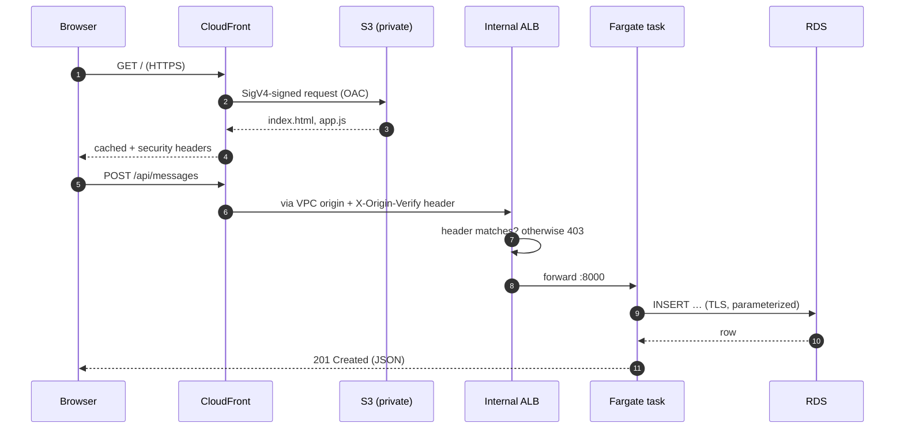

</details>

### 📁 Repository layout

```text
.
├── app/
│   ├── backend/              FastAPI API · unit tests · multi-stage Dockerfile
│   └── frontend/             static HTML/JS (+ nginx Dockerfile, local only)
├── infra/
│   ├── bootstrap/            one-time: state bucket · shared ECR · CI IAM users & roles
│   ├── modules/
│   │   ├── network/          VPC · 3 subnet tiers × AZs · NAT none/single/per_az · S3 endpoint · flow logs
│   │   ├── security/         SG chain  CloudFront → ALB → app → db
│   │   ├── kms/              customer-managed key (RDS, logs, SNS, secret)
│   │   ├── database/         RDS PostgreSQL · force_ssl · managed secret
│   │   ├── compute/          ECS cluster/service/task · internal ALB · autoscaling · IAM
│   │   ├── cdn/              S3 + CloudFront (OAC, VPC origin, headers) · optional WAF
│   │   ├── monitoring/       SNS · 8 alarms · log metric · backup events · dashboard
│   │   └── backup/           AWS Backup vault + plan · DR copy · vault lock
│   ├── stack/                composition root (wires the modules for ONE environment)
│   └── envs/{dev,prod}/      terraform.tfvars + backend.hcl, values only
├── scripts/                  smoke-test.sh · restore-drill.sh · load-test.js (k6)
├── ci/aws-auth.sh            CI key → 1-hour role session
├── .gitlab-ci.yml            the pipeline
└── docker-compose.yml        the full stack locally
```

### 🏷️ Naming & tagging convention

| Rule | Example |
|---|---|
| `<project>-<env>-<component>` | `guestbook-dev-alb`, `guestbook-prod-postgres`, `guestbook-dev-api-execution` |
| Shared (account-level) resources | `guestbook-api` (ECR), `guestbook-tfstate-<account-id>`, `guestbook-ci-deploy` |
| Log groups | `/guestbook-<env>/ecs/api`, `/guestbook-<env>/vpc-flow-logs` |
| **Mandatory tags** (provider `default_tags`, so they can't be forgotten) | `Project` · `Environment` · `Owner` · `ManagedBy=terraform` · `Repository` · `CostCenter` |
| Opt-in tags | `backup=true` → included in the AWS Backup plan |

The naming isn't just cosmetic: **IAM permissions are scoped by these prefixes**. The CI deploy role can
manage `guestbook-dev-*` and `guestbook-prod-*` but can never touch `guestbook-ci-*`, its own identity.

---

<a id="diagrams"></a>

## 🗺️ Detailed diagrams

> [!TIP]
> **Click any diagram to open it full size.** Use **🔍 Zoom (SVG)** for a vector version that stays sharp at any
> zoom level (Ctrl + mouse wheel in the browser). Sources are plain-text Mermaid in
> [`docs/diagrams/*.mmd`](docs/diagrams), so they can be reviewed and changed like code.

| # | Diagram | # | Diagram |
|:-:|---|:-:|---|
| 01 | [Full AWS architecture](#d01) | 07 | [CI/CD pipeline: 10 stages, 16 jobs](#d07) |
| 02 | [Network: subnets, routing and gateways](#d02) | 08 | [Zero-downtime deploy and the two rollback layers](#d08) |
| 03 | [Security-group chain (least-privilege ports)](#d03) | 09 | [Monitoring, logging and alerting](#d09) |
| 04 | [IAM and secrets: who can do what](#d04) | 10 | [Backups and disaster recovery (four layers)](#d10) |
| 05 | [Request lifecycle](#d05) | 11 | [Restore drill: proving backups actually work](#d11) |
| 06 | [Terraform structure and module dependencies](#d06) | 12 | [dev vs prod: same code, different values](#d12) |

<a id="d01"></a>

### 01 · Full AWS architecture

Every component of the dev environment and how they connect. Users only reach CloudFront: `/*` is served from a private S3 bucket through Origin Access Control, and `/api/*` goes through a CloudFront **VPC origin** to an **internal** ALB, so nothing in the VPC is reachable from the internet. Fargate tasks talk to RDS over TLS, pull images from ECR, get the DB password from Secrets Manager at start-up and ship JSON logs to CloudWatch. Alarms and backup failures go to an encrypted SNS topic. GitLab CI builds the image, pushes it to ECR and Docker Hub, and applies Terraform with state in a locked S3 bucket.

[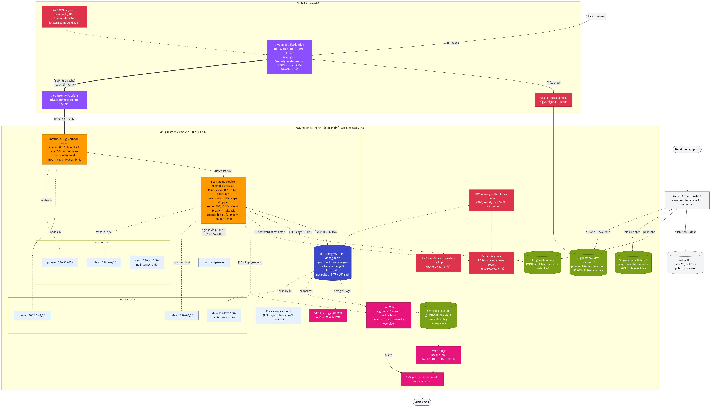](docs/diagrams/rendered/01-aws-architecture.svg)

<sub>🔍 <a href="docs/diagrams/rendered/01-aws-architecture.svg"><b>Zoom (SVG)</b></a> · 🖼️ <a href="docs/diagrams/rendered/01-aws-architecture.png">PNG (high-res)</a> · ✏️ <a href="docs/diagrams/01-aws-architecture.mmd">Mermaid source</a> · <a href="#diagrams">↑ back to list</a></sub>

<a id="d02"></a>

### 02 · Network: subnets, routing and gateways

VPC 10.20.0.0/16 across two AZs with three subnet tiers per AZ (/20 each). **Public** subnets route 0.0.0.0/0 to the internet gateway. **Private** subnets hold the internal ALB, with one route table per AZ so prod NAT traffic stays in-zone. **Data** subnets have only the local route, so the database has no path to the internet at all. A free S3 gateway endpoint keeps ECR image layers on the AWS network, VPC flow logs record rejected traffic, and the default security group is stripped of all rules.

[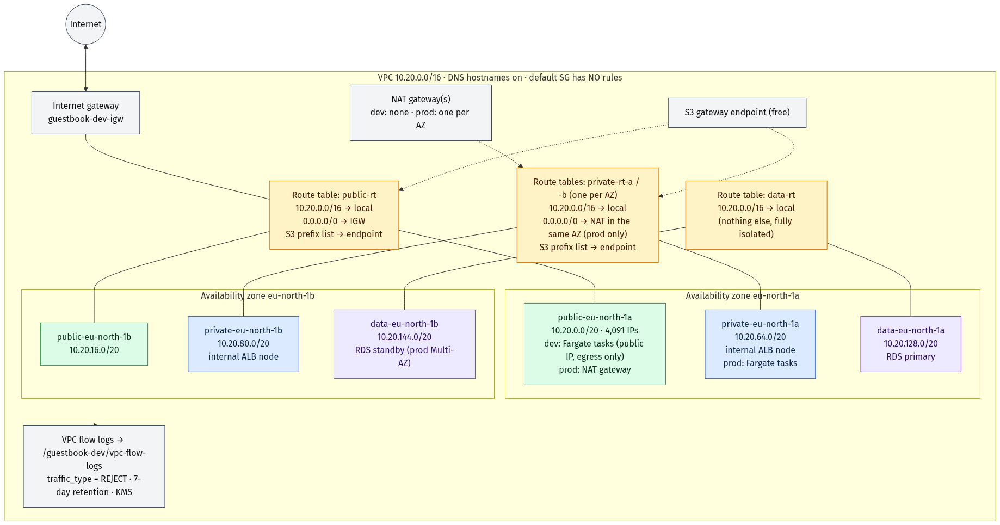](docs/diagrams/rendered/02-network.svg)

<sub>🔍 <a href="docs/diagrams/rendered/02-network.svg"><b>Zoom (SVG)</b></a> · 🖼️ <a href="docs/diagrams/rendered/02-network.png">PNG (high-res)</a> · ✏️ <a href="docs/diagrams/02-network.mmd">Mermaid source</a> · <a href="#diagrams">↑ back to list</a></sub>

<a id="d03"></a>

### 03 · Security-group chain (least-privilege ports)

Each tier accepts traffic only from the tier in front of it, referenced by **security-group ID**, never by CIDR. The ALB accepts port 80 only from CloudFront's managed origin-facing prefix list. App tasks accept 8000 only from the ALB SG. The database accepts 5432 only from the app SG and has **no egress**. Anything else is dropped, and the ALB has no public IP to begin with.

[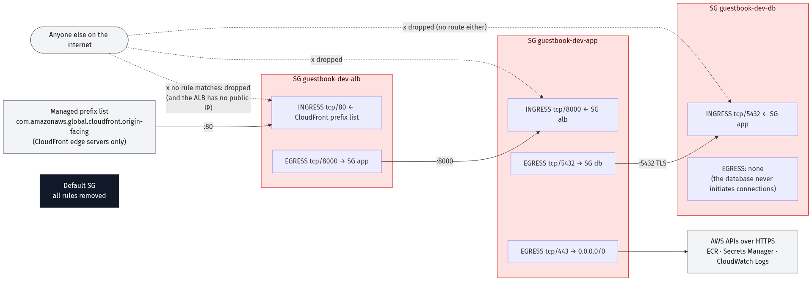](docs/diagrams/rendered/03-security-groups.svg)

<sub>🔍 <a href="docs/diagrams/rendered/03-security-groups.svg"><b>Zoom (SVG)</b></a> · 🖼️ <a href="docs/diagrams/rendered/03-security-groups.png">PNG (high-res)</a> · ✏️ <a href="docs/diagrams/03-security-groups.mmd">Mermaid source</a> · <a href="#diagrams">↑ back to list</a></sub>

<a id="d04"></a>

### 04 · IAM and secrets: who can do what

**CI:** two IAM users whose only permission is **sts:AssumeRole** on one role each (1-hour sessions). The deploy key is a **protected** GitLab variable, so only pipelines on main can use it. The deploy role is scoped by service, region and name prefix, with an explicit deny on editing CI identities. **Runtime:** the ECS execution role can read exactly one secret and decrypt with one key. The task role has **no permissions**. The DB password is generated and rotated by RDS and injected at container start, so it's never in code, CI, logs or Terraform state.

[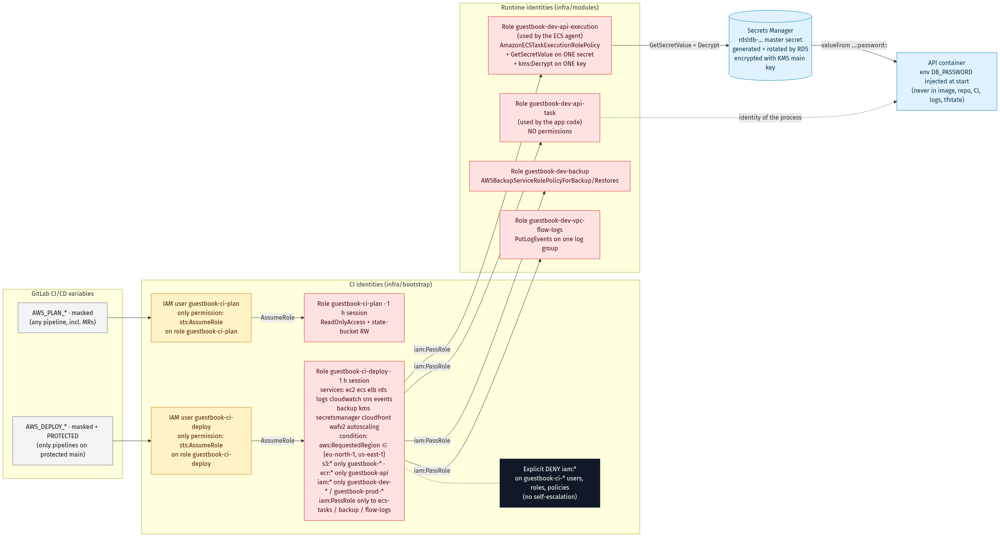](docs/diagrams/rendered/04-iam-secrets.svg)

<sub>🔍 <a href="docs/diagrams/rendered/04-iam-secrets.svg"><b>Zoom (SVG)</b></a> · 🖼️ <a href="docs/diagrams/rendered/04-iam-secrets.png">PNG (high-res)</a> · ✏️ <a href="docs/diagrams/04-iam-secrets.mmd">Mermaid source</a> · <a href="#diagrams">↑ back to list</a></sub>

<a id="d05"></a>

### 05 · Request lifecycle

What happens when a user loads the page and posts a message: HTTP→HTTPS redirect, edge caching, the SigV4-signed S3 read via OAC, the **X-Origin-Verify** header check on the ALB (default action 403), pydantic input validation, a parameterized INSERT over TLS, and security headers on every response.

[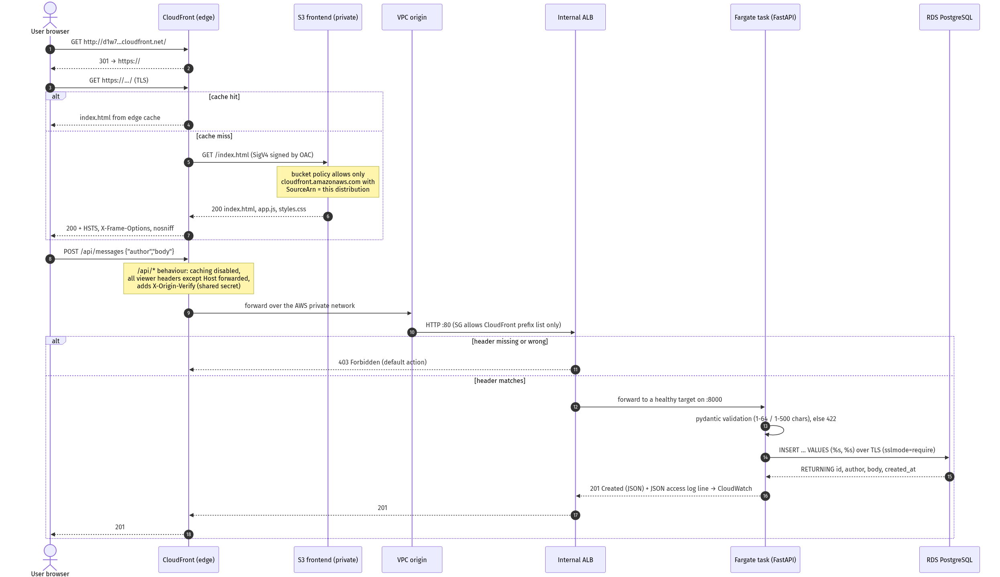](docs/diagrams/rendered/05-request-flow.svg)

<sub>🔍 <a href="docs/diagrams/rendered/05-request-flow.svg"><b>Zoom (SVG)</b></a> · 🖼️ <a href="docs/diagrams/rendered/05-request-flow.png">PNG (high-res)</a> · ✏️ <a href="docs/diagrams/05-request-flow.mmd">Mermaid source</a> · <a href="#diagrams">↑ back to list</a></sub>

<a id="d06"></a>

### 06 · Terraform structure and module dependencies

**bootstrap** is applied once: the state bucket, the shared ECR repository and the CI identities. **stack** is the single composition root that wires 8 reusable modules together. **envs/dev** and **envs/prod** contain only values (tfvars and a backend key), so the two environments can't drift in code. Arrows show which outputs feed which module.

[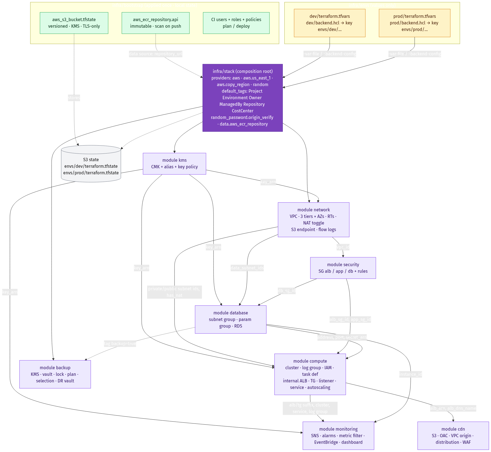](docs/diagrams/rendered/06-terraform-modules.svg)

<sub>🔍 <a href="docs/diagrams/rendered/06-terraform-modules.svg"><b>Zoom (SVG)</b></a> · 🖼️ <a href="docs/diagrams/rendered/06-terraform-modules.png">PNG (high-res)</a> · ✏️ <a href="docs/diagrams/06-terraform-modules.mmd">Mermaid source</a> · <a href="#diagrams">↑ back to list</a></sub>

<a id="d07"></a>

### 07 · CI/CD pipeline: 10 stages, 16 jobs

lint (ruff, hadolint, fmt/validate, tflint, Checkov, gitleaks) → test (pytest + SonarQube quality gate) → build the image **once** → Trivy gate on fixable HIGH/CRITICAL **before** any push → publish to ECR and Docker Hub → plan with a **read-only** role → apply the saved plan to dev → smoke test → automatic rollback on failure → **manual** promotion of the same image to prod.

[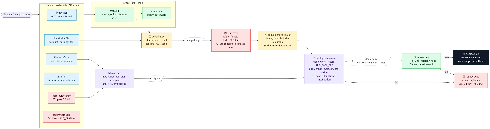](docs/diagrams/rendered/07-cicd-pipeline.svg)

<sub>🔍 <a href="docs/diagrams/rendered/07-cicd-pipeline.svg"><b>Zoom (SVG)</b></a> · 🖼️ <a href="docs/diagrams/rendered/07-cicd-pipeline.png">PNG (high-res)</a> · ✏️ <a href="docs/diagrams/07-cicd-pipeline.mmd">Mermaid source</a> · <a href="#diagrams">↑ back to list</a></sub>

<a id="d08"></a>

### 08 · Zero-downtime deploy and the two rollback layers

ECS rolling update with 100 % minimum healthy: the old task keeps serving until the new one passes health checks. If the new version **crashes**, the ECS deployment circuit breaker rolls back by itself. If it **runs but behaves wrong**, the smoke test fails and the rollback job restores the task definition recorded just before the deploy.

[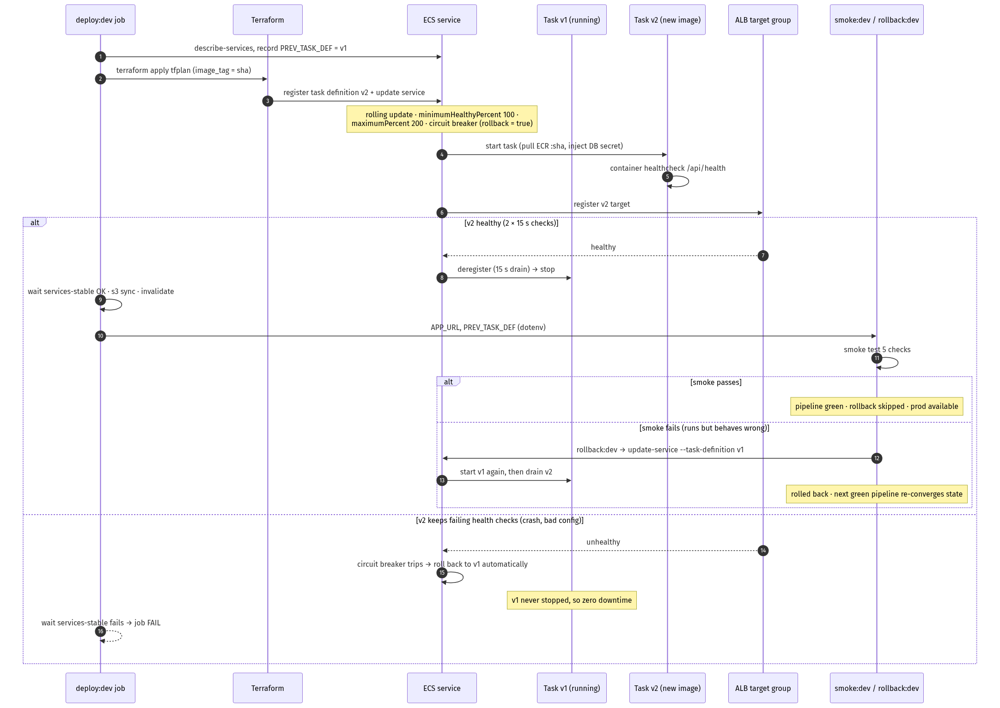](docs/diagrams/rendered/08-deploy-rollback.svg)

<sub>🔍 <a href="docs/diagrams/rendered/08-deploy-rollback.svg"><b>Zoom (SVG)</b></a> · 🖼️ <a href="docs/diagrams/rendered/08-deploy-rollback.png">PNG (high-res)</a> · ✏️ <a href="docs/diagrams/08-deploy-rollback.mmd">Mermaid source</a> · <a href="#diagrams">↑ back to list</a></sub>

<a id="d09"></a>

### 09 · Monitoring, logging and alerting

Sources: structured JSON app logs, ALB, ECS and RDS metrics, RDS logs, VPC flow logs and AWS Backup events. A metric filter turns ERROR log lines into a metric. There are 8 CloudWatch alarms plus an EventBridge rule for backup failures, all going to an encrypted SNS topic and email. A dashboard defined in Terraform shows traffic, errors, latency, saturation and recent errors. The same metrics drive target-tracking autoscaling.

[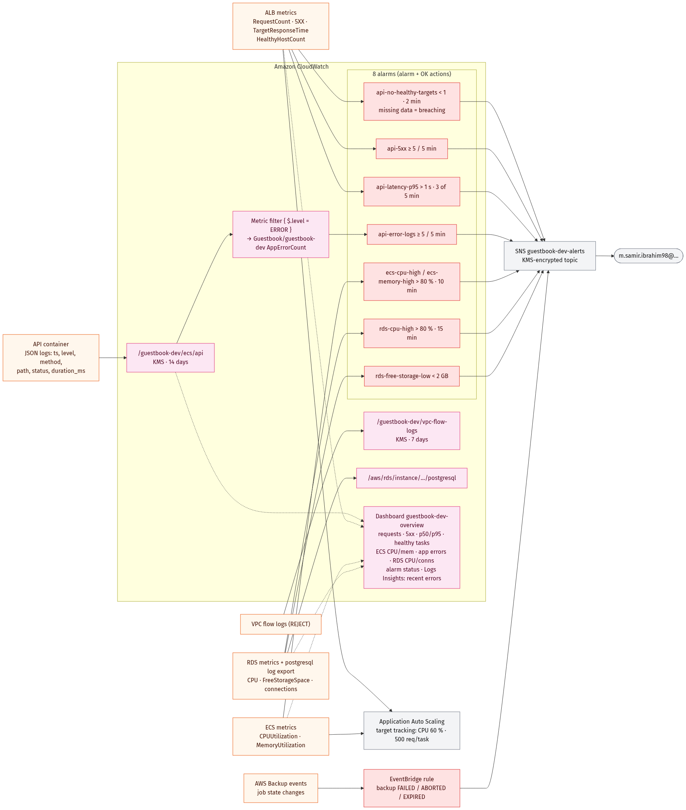](docs/diagrams/rendered/09-monitoring.svg)

<sub>🔍 <a href="docs/diagrams/rendered/09-monitoring.svg"><b>Zoom (SVG)</b></a> · 🖼️ <a href="docs/diagrams/rendered/09-monitoring.png">PNG (high-res)</a> · ✏️ <a href="docs/diagrams/09-monitoring.mmd">Mermaid source</a> · <a href="#diagrams">↑ back to list</a></sub>

<a id="d10"></a>

### 10 · Backups and disaster recovery (four layers)

1) RDS automated backups with point-in-time recovery. 2) An AWS Backup plan (daily, weekly in prod) into a vault with its **own** KMS key, selected by tag. 3) In prod, a cross-region copy and a **vault lock** in compliance mode (ransomware protection). 4) S3 versioning on the frontend and state buckets. Failed or aborted backup jobs raise an email alert.

[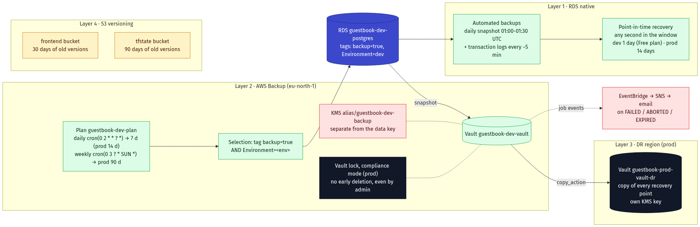](docs/diagrams/rendered/10-backup-dr.svg)

<sub>🔍 <a href="docs/diagrams/rendered/10-backup-dr.svg"><b>Zoom (SVG)</b></a> · 🖼️ <a href="docs/diagrams/rendered/10-backup-dr.png">PNG (high-res)</a> · ✏️ <a href="docs/diagrams/10-backup-dr.mmd">Mermaid source</a> · <a href="#diagrams">↑ back to list</a></sub>

<a id="d11"></a>

### 11 · Restore drill: proving backups actually work

scripts/restore-drill.sh writes marker A, records time T, writes marker B, restores the database **to time T as a new instance**, then queries the copy from inside the VPC with a one-off ECS task. PASS means A is present and B is absent, so the restore landed on the exact second requested. It reports the measured RTO and always deletes the copy.

[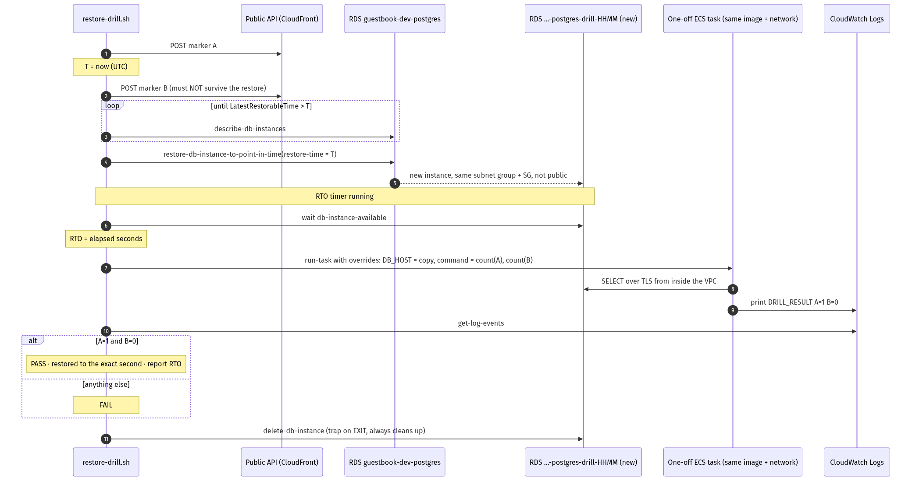](docs/diagrams/rendered/11-restore-drill.svg)

<sub>🔍 <a href="docs/diagrams/rendered/11-restore-drill.svg"><b>Zoom (SVG)</b></a> · 🖼️ <a href="docs/diagrams/rendered/11-restore-drill.png">PNG (high-res)</a> · ✏️ <a href="docs/diagrams/11-restore-drill.mmd">Mermaid source</a> · <a href="#diagrams">↑ back to list</a></sub>

<a id="d12"></a>

### 12 · dev vs prod: same code, different values

dev (deployed, about $1.70/day): 2 AZs, no NAT, 1–3 small tasks, single-AZ micro database, no WAF. prod (defined as code, manual promotion, about $8–10/day): 3 AZs, NAT per AZ with private tasks, 2–10 larger tasks, Multi-AZ database with deletion protection, WAF, 14/90-day backups, cross-region copy and vault lock.

[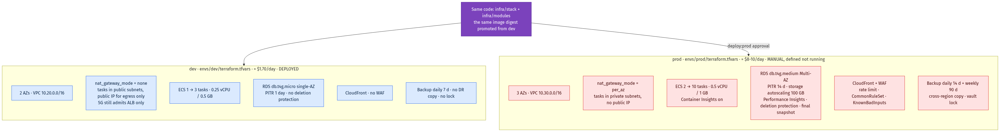](docs/diagrams/rendered/12-dev-vs-prod.svg)

<sub>🔍 <a href="docs/diagrams/rendered/12-dev-vs-prod.svg"><b>Zoom (SVG)</b></a> · 🖼️ <a href="docs/diagrams/rendered/12-dev-vs-prod.png">PNG (high-res)</a> · ✏️ <a href="docs/diagrams/12-dev-vs-prod.mmd">Mermaid source</a> · <a href="#diagrams">↑ back to list</a></sub>

---

## 🧠 Why I chose what I chose

Every choice below was made against the same four criteria: **security by default, low operational burden,
cost at assessment scale, and a clean path to production.**

### ☁️ Cloud provider: AWS

> **Chosen:** AWS · **Considered:** GCP (Cloud Run + Cloud SQL), Azure (Container Apps + Flexible Server)

- **Free plan credits ($200)** cover the entire exercise, including the parts that are never free elsewhere
  (load balancer, managed DB).
- The services I needed are **mature and composable**: ECS, RDS, CloudFront, AWS Backup, KMS. Notably
  **CloudFront VPC origins**, which let the API run with *no public endpoint at all*. That's the single biggest
  security win in this design and hard to match on other clouds at this price.
- It's the most common target for this kind of role, so the patterns used (IAM scoping, SG chaining, KMS key
  policies) transfer directly.
- **Honest trade-off:** GCP Cloud Run would be cheaper at idle (scales to zero and needs no load balancer). AWS
  costs about $1.70/day while running, which is irrelevant for a demo that's destroyed afterwards.

### 🐳 Compute: ECS Fargate (not EC2, EKS or Lambda)

| Option | Verdict | Reason |
|---|:---:|---|
| **ECS Fargate** | ✅ | No servers or AMIs to patch. Per-task IAM roles. Native ALB integration. Rolling deploys with a **circuit breaker that rolls back automatically**. Pay per task-second. |
| EC2 + Docker | ❌ | Mine to patch, harden and scale. Wrong use of time for a stateless API. |
| EKS | ❌ | ~$73/month control plane plus real complexity, for *one* service. Kubernetes earns its keep at 10+ services. |
| Lambda | ❌ | Cold starts, and DB connection storms without RDS Proxy. The brief asks for a container. |

### 🌐 Frontend: S3 + CloudFront (not a container)

Containerizing *everything* isn't best practice. **Use the right kind of service for each tier.** Static files
need no runtime: S3 + CloudFront gives global caching, HTTPS, compression and HTTP/3 for **cents per month**,
with nothing to patch or scale. An nginx container on Fargate would cost about $10/month and add an attack
surface for no benefit. (nginx *is* used locally in `docker compose`, standing in for CloudFront.)

### 🐘 Database: managed RDS PostgreSQL (not Postgres in a container)

Running a stateful database in a container in production means owning **backups, PITR, failover, patching,
storage and encryption** yourself. RDS gives all of that, plus Multi-AZ with one variable. PostgreSQL because
it's the safest default for relational data. `db.t4g.micro` (Graviton) because it's free-tier eligible.

### 🔐 Edge: CloudFront **VPC origin** → **internal** ALB

<details>
<summary><b>Why this matters (click)</b></summary>

The usual pattern is a *public* ALB "restricted" to CloudFront's IP prefix list. It's still internet-addressable,
and anyone who learns its DNS name can probe it.

With a **VPC origin**, CloudFront connects to an **internal** ALB over AWS's private network:

- The ALB has **no public IP and no public DNS resolution**. There's nothing to scan.
- A second layer: CloudFront adds a secret `X-Origin-Verify` header (generated by Terraform). The ALB's default
  action is **403**, and only requests carrying the header are forwarded.
- **One domain** serves both the frontend and `/api/*`, so there's **no CORS** configuration to get wrong.

</details>

### 🧩 IaC structure: one root stack + per-environment `tfvars`

> **Chosen:** `infra/stack` + `envs/{dev,prod}/terraform.tfvars` · **Considered:** a copied `main.tf` per env, Terragrunt, workspaces

- **dev and prod can't drift in code.** They differ only in *values*: `nat_gateway_mode`, `db_multi_az`,
  `enable_waf`, `min_tasks` and so on. Reviewing a prod change means reading a `tfvars` diff.
- Workspaces hide which environment you're in, which is a classic way to apply to prod by accident. Separate
  state keys plus explicit `-var-file` are visible and greppable.
- Terragrunt would solve the same problem but adds another tool. Plain Terraform was enough here.
- **State:** S3 with **`use_lockfile = true`** (S3-native locking, Terraform ≥ 1.10). There's no DynamoDB table,
  which is now the recommended approach. The bucket is versioned, KMS-encrypted and TLS-only.

### 🔁 CI/CD: GitLab CI on a self-hosted instance

- I run self-hosted **GitLab CE + SonarQube** day to day, so the pipeline uses the real toolchain, including a
  **SonarQube quality gate**, not just a demo linter.
- **Build once, promote the same image.** The image that passed tests and Trivy in dev is byte-for-byte what
  reaches prod. ECR tags are **immutable**, so a tag can never be silently overwritten.
- **Scan before push.** Trivy runs on the image *tarball* before it reaches any registry, so a vulnerable image
  is never published. It caught real issues during development: **3 HIGH CVEs in Starlette**, fixed by
  bumping dependencies.
- **Two registries.** ECR is what deploys use: private, controlled by IAM, close to the compute. **Docker Hub**
  (`moes98/test2026`) is a public showcase, so reviewers can `docker run` the image.

### 💸 No NAT gateway in dev

The NAT gateway is the usual hidden cost on AWS (~$35/month per AZ). In dev, tasks sit in public subnets with a
public IP used **for egress only**. Their security group still admits traffic from the ALB alone, so nothing
from the internet can reach them. Prod uses `nat_gateway_mode = "per_az"`, which puts tasks in private subnets
with no public IP. **Same code, one variable.**

---

## 🔁 CI/CD pipeline


The pipeline has **10 stages and 16 jobs**. Every stage only starts when the previous one passed, so a problem
is caught at the **cheapest possible point**: a formatting error fails in about 10 seconds, long before anything
touches AWS.

### When does what run?

| Trigger | Stages that run | AWS credentials available |
|---|---|---|
| **Merge request** (any branch) | ① lint → ② test → ③ build → ④ scan → ⑥ plan | **Read-only** plan key only |
| **Push / merge to `main`** | all 10 stages | Plan key + **deploy key** (protected variable) |
| **Any other branch push** | nothing (`workflow:rules`) | none |

A merge request can **look** at AWS (to produce a plan) but can **never change** it. The deploy key is a
GitLab *protected* variable, which GitLab only injects into pipelines running on the protected `main` branch,
even if someone edits `.gitlab-ci.yml` in their branch.

### Pipeline-wide safety settings

| Setting | Effect |
|---|---|
| `interruptible: true` (default) | A newer push cancels an older, now-pointless pipeline. Deploy jobs set `interruptible: false` so a deploy is **never killed halfway**. |
| `resource_group: tf-dev` / `tf-prod` | Only **one** pipeline at a time can plan or apply an environment. No two `terraform apply` runs can race on the same state. |
| `needs:` | Jobs start as soon as *their* inputs are ready, not when the whole previous stage is done. |
| Pinned tool versions | Terraform `1.16`, ruff `0.16.9`, `docker:28`. The same commit always lints the same way. |

---

### ① `lint`: catch problems before running anything

Six independent jobs run in parallel. None needs AWS credentials, and together they take about 1 minute.

<details open>
<summary><b><code>lint:python</code>, ruff (≈10 s)</b></summary>

```bash
ruff check .            # lint: bugs, bad patterns, insecure calls
ruff format --check .   # formatting: fails if any file WOULD be reformatted (changes nothing)
```

Rules enabled in [`pyproject.toml`](app/backend/pyproject.toml): `select = ["E","F","I","B","UP","S"]`

| Code | Rule set | Example of what it catches |
|---|---|---|
| `E` | pycodestyle | style errors, lines over 100 characters |
| `F` | pyflakes | unused imports, undefined names (real bugs) |
| `I` | isort | imports in the wrong order |
| `B` | flake8-bugbear | likely bugs, e.g. a mutable default argument `def f(x=[])` |
| `UP` | pyupgrade | outdated syntax. It flagged `timezone.utc` → `datetime.UTC` during this build. |
| `S` | bandit (security) | `eval()`, hard-coded passwords, `subprocess(shell=True)`, insecure temp files |

Deliberate exceptions: `S101` (`assert`) is allowed in `tests/`, and `B008` is ignored because `Depends()` in
default arguments is normal FastAPI style. **Why ruff:** one Rust tool replaces flake8, isort, pyupgrade,
bandit and black, and it's 10–100× faster.

</details>

<details>
<summary><b><code>lint:dockerfile</code>, hadolint (≈6 s)</b></summary>

```bash
hadolint --failure-threshold warning app/backend/Dockerfile app/frontend/Dockerfile
```

hadolint parses each Dockerfile into an AST and checks it against Docker best practices, and it runs
**ShellCheck on every `RUN` line**. `--failure-threshold warning` means **warnings fail the job too**, not just
errors.

| Rule | Catches |
|---|---|
| DL3002 | last `USER` is root |
| DL3006 / DL3007 | untagged base image or `:latest` (not reproducible) |
| DL3008 / DL3018 | `apt-get` / `apk add` without pinned versions |
| DL3009 | apt lists not cleaned (bigger image) |
| DL3025 | `CMD` in shell form (PID 1 doesn't receive `SIGTERM`, so containers don't stop cleanly) |
| DL4006 | pipes without `set -o pipefail` (hidden failures) |
| SC2086 | unquoted shell variables |

</details>

<details>
<summary><b><code>lint:terraform</code>, fmt + validate (≈70 s)</b></summary>

```bash
terraform fmt -check -recursive -diff infra
for d in infra/bootstrap infra/stack; do
  (cd $d && terraform init -backend=false && terraform validate)
done
```

| Step | What it proves |
|---|---|
| `fmt -check -recursive -diff` | every `.tf` file uses canonical formatting. `-diff` prints exactly what's wrong. |
| `init -backend=false` | downloads providers and modules **without connecting to the S3 state**, so it needs no credentials and can't touch real infrastructure |
| `validate` | the configuration is **internally consistent**: valid syntax, every reference exists (`module.network.vpc_id`), argument names and types are right, required module inputs are passed |

It runs on **both root modules**. Validating `stack` also validates all 8 child modules through it.

</details>

<details>
<summary><b><code>lint:tflint</code>, deeper Terraform linting (≈12 s)</b></summary>

```bash
tflint --init && tflint --recursive --config infra/.tflint.hcl
```

`validate` checks that the code is *well-formed*. tflint checks that it's **sensible**. Two plugins are configured
in [`infra/.tflint.hcl`](infra/.tflint.hcl):

**Terraform ruleset (`recommended` preset + extras):**

| Rule | Catches |
|---|---|
| `terraform_unused_declarations` | dead variables, locals or data sources. It caught an unused `aws_caller_identity` in the backup module during this build. |
| `terraform_documented_variables` / `_outputs` | every variable and output **must** have a `description`, so the modules document themselves |
| `terraform_naming_convention` | `snake_case` names everywhere |
| `terraform_required_providers` / `_version` | every module pins its provider and Terraform versions |
| `terraform_deprecated_syntax` | legacy `"${var.x}"` interpolation |

**AWS ruleset (`tflint-ruleset-aws` 0.40):** knows AWS's real valid values, so it catches errors that would
otherwise only show up at `apply` time: invalid instance classes, nonexistent engine versions, bad region or AZ
names, deprecated arguments.

</details>

<details>
<summary><b><code>security:checkov</code>, infrastructure security scan (≈15 s)</b></summary>

```bash
checkov -d infra --config-file infra/.checkov.yaml -o cli -o junitxml
```

Checkov evaluates the Terraform against 1,000+ policies (CIS AWS benchmark and AWS best practice). Results are
also published as a **JUnit report**, so they appear in GitLab's *Tests* tab.

**Result: 279 passed · 0 failed.** The first scan of this code showed **43 failures**. The real gaps were fixed
(ALB deletion protection, explicit key policies on the backup KMS keys, cleanup of incomplete S3 multipart
uploads, IAM database authentication, explicit WAF rules), and every remaining exception is listed with a
written reason in [`infra/.checkov.yaml`](infra/.checkov.yaml), in three groups:

| Group | Example |
|---|---|
| **Design decision** | ALB listener is HTTP: it's *internal* and only reachable through the CloudFront VPC origin. CI uses IAM users: the GitLab is private, so OIDC is impossible. |
| **Toggled per environment** | Multi-AZ, deletion protection, Performance Insights and Container Insights: off in dev, **on in `envs/prod`** |
| **False positive** | Security groups are "unattached" only because they're attached in *another* module |

</details>

<details>
<summary><b><code>security:gitleaks</code>, secret detection over the full history (≈7 s)</b></summary>

```bash
gitleaks git . --redact --verbose --report-format sarif --report-path gitleaks.sarif
```

- 150+ detectors: AWS keys (`AKIA…`), private keys, GitLab/GitHub/Slack tokens, passwords in connection
  strings, high-entropy strings.
- **`GIT_DEPTH: 0`** clones the **entire history**. A secret committed and then "deleted" in a later commit is
  **still leaked**, because it's in history. A scan of only the latest files would miss it.
- `--redact` masks anything it finds in the job log, so the scan doesn't leak the secret a second time.

</details>

---

### ② `test`: does it work, and is it good code?

| Job | What happens | Output in GitLab |
|---|---|---|
| `test:unit` | `pytest` runs **9 tests** against the *real* FastAPI app, with the database swapped for an in-memory repository (the app depends on a `MessageRepository` interface). It covers health, readiness up and down, create and list, ordering, input validation and limit clamping. | **Tests** tab (JUnit), **coverage %** on the MR (79 %), and a line-by-line coverage overlay in the MR diff (Cobertura) |
| `sonarqube` | Uploads source and coverage to SonarQube and **waits for the quality gate** (`sonar.qualitygate.wait=true`). Bugs, vulnerabilities, security hotspots, code smells, duplication or coverage below the gate **fail the pipeline**. | SonarQube project dashboard |

### ③ `build`: one image per commit

`build:image` runs Docker-in-Docker and:
1. builds `app/backend` with `--pull`, so the base image is always fresh with the latest OS patches
2. tags it `guestbook-api:<commit-sha>`, never a mutable tag like `latest`
3. labels it with `org.opencontainers.image.revision` (the full SHA) and `.source` (the repo URL), so any running
   container can be traced back to the exact commit
4. saves it as `image.tar.gz`, a **pipeline artefact, not pushed anywhere yet**

**Build once, deploy many:** this exact tarball is what gets scanned, pushed, deployed to dev and later promoted
to prod. It's never rebuilt, because a rebuild could pick up different dependencies.

### ④ `scan`: is it safe to publish?

`scan:trivy` scans the **tarball**, *before* it reaches any registry:

```bash
trivy image --input image.tar.gz --format json --output trivy.json          # full report (artefact)
trivy convert --format template --template @/contrib/gitlab.tpl ...         # GitLab security widget
trivy image --input image.tar.gz --exit-code 1 --severity HIGH,CRITICAL --ignore-unfixed   # the GATE
```

The gate fails the pipeline on any **HIGH or CRITICAL vulnerability that has a fix available**.
`--ignore-unfixed` keeps the gate actionable: it only blocks on things you can actually fix by upgrading.

> [!IMPORTANT]
> **This gate caught real vulnerabilities during development.** The first image had **3 HIGH CVEs in Starlette**
> (CVE-2025-62727 Range-header DoS, CVE-2026-48818 SSRF via UNC paths, CVE-2026-54283 form-limit DoS), pulled in
> by an older FastAPI. Bumping FastAPI 0.118 → 0.142 and Starlette → 1.7.0 fixed all three. Without the gate,
> they would have shipped.

### ⑤ `publish`: push the approved image *(main only)*

`publish:image` assumes the deploy role and pushes to **two registries**:

| Registry | Tags | Purpose |
|---|---|---|
| **Amazon ECR** `guestbook-api` | `<sha>` (immutable) | **What AWS deploys from.** Private, IAM-controlled, close to Fargate, scanned again on push. If the tag already exists (a pipeline re-run), the push is skipped, because overwriting is impossible by design. |
| **Docker Hub** [`moes98/test2026`](https://hub.docker.com/r/moes98/test2026) | `<sha>` + `latest` | Public showcase: anyone can `docker run moes98/test2026:latest`. Skipped automatically if `DOCKERHUB_TOKEN` isn't set. |

### ⑥ `plan`: what exactly will change?

`plan:dev` uses the **read-only** role:

1. `terraform init` against the dev state (`s3://guestbook-tfstate-<account>/envs/dev/terraform.tfstate`)
2. `terraform plan -var-file=../envs/dev/terraform.tfvars -out=tfplan`, with `image_tag` set to this commit
3. a JSON summary (`create` / `update` / `delete` counts), shown as the **Terraform widget on the merge request**

The saved `tfplan` file is passed to the deploy job, so **what was reviewed is exactly what gets applied**. A fresh
plan at apply time could differ if something changed in between.

### ⑦ `deploy`: roll out to dev *(main only)*

`deploy:dev` assumes the **deploy** role, then:

| Step | Command | Why |
|---|---|---|
| 1 | record the ECS task definition **currently running** | the rollback job needs to know where to return to |
| 2 | `terraform apply tfplan` | infrastructure changes + a new task definition pointing at `<sha>` |
| 3 | `aws ecs wait services-stable` | waits for the **rolling deployment**: new tasks start, pass ALB health checks, and only then are old tasks drained and stopped. **Zero downtime** (`minimum_healthy_percent = 100`). |
| 4 | `aws s3 sync app/frontend s3://… --delete` | upload the static frontend, removing deleted files |
| 5 | `aws cloudfront create-invalidation --paths "/*"` | clear the CDN cache so users get the new files right away |
| 6 | write `APP_URL` + `PREV_TASK_DEF` to a dotenv artefact | later jobs read them. `APP_URL` also becomes the clickable link in **GitLab → Environments → dev**. |

If the new tasks keep failing their health checks during step 3, the **ECS deployment circuit breaker** stops the
rollout and **reverts to the last working version by itself**, and the job fails.

### ⑧ `verify`: is it actually working?

`smoke:dev` runs [`scripts/smoke-test.sh`](scripts/smoke-test.sh) against the **public CloudFront URL**, the same
path a real user takes:

| # | Check | Proves |
|:-:|---|---|
| 1 | `GET /` returns the page `<title>` | CloudFront → S3 (OAC) works, HTTPS works |
| 2 | `GET http://…` returns **301** | HTTP is redirected to HTTPS |
| 3 | `GET /api/health` → `version == <this commit>` | **the new code is really live**, not the old version still answering |
| 4 | `GET /api/ready` → `database: up` | the API can reach RDS (security groups, TLS, secret injection all working) |
| 5 | `POST` a unique marker, then `GET` it back | full **write + read round trip** through CloudFront → VPC origin → ALB → Fargate → RDS |

Each request is retried for up to about 60 s, because CloudFront and the ALB can take a moment to settle after a deploy.

<a id="rollback"></a>

### ⑨ `rollback`: undo automatically *(main only, **only on failure**)*

```yaml
rollback:dev:
  rules:
    - if: $CI_COMMIT_BRANCH == $CI_DEFAULT_BRANCH
      when: on_failure        # ← runs ONLY if an earlier job failed
```

On a healthy pipeline this job shows as **skipped**, which is the expected result. When something fails, it
restores the task definition recorded in step ⑦ and waits until the service is stable again.

**Two independent rollback layers**, because failures come in two kinds:

| What went wrong | Example | Who rolls back | How |
|---|---|---|---|
| New version **crashes** | bad import, wrong port, can't start | **ECS circuit breaker** | inside the deploy, automatically, without the pipeline |
| New version **runs but behaves wrong** | returns wrong data, can't write to the DB | **`rollback:dev` job** | after the smoke test fails |
| Pipeline fails *before* deploying | lint, test or Trivy failure | nothing to roll back | the job exits cleanly: *"No previous task definition recorded"* |

<details>
<summary><b>Example: what a failed deploy looks like</b></summary>

```text
deploy:dev    ✅  records PREV_TASK_DEF = guestbook-dev-api:7, deploys :8
smoke:dev     ❌  "SMOKE FAIL: written message not returned"
rollback:dev  ✅  "Rolling ECS back to guestbook-dev-api:7" → services-stable
                  "Rolled back. The next successful pipeline on main re-converges Terraform state."
```

Terraform state still says `:8` after a rollback. The next green pipeline re-applies and converges, which is a
known and accepted property of out-of-band rollbacks.

</details>

<a id="prod"></a>

### ⑩ `promote`: production *(main only, **manual**)*

`deploy:prod` is a **▶ manual job**: production requires a **human approval** after dev has been verified. It:

1. uses the **same image tag** that just passed every gate in dev (no rebuild)
2. runs `terraform plan` + `apply` with [`envs/prod/terraform.tfvars`](infra/envs/prod/terraform.tfvars) against
   its **own state file** (`envs/prod/terraform.tfstate`) and its own `resource_group`
3. is marked `allow_failure: true`, so the dev pipeline is green whether or not someone promotes

**What changes in prod is configuration, never code:**

| Setting | dev | prod |
|---|---|---|
| Availability zones | 2 | **3** |
| API tasks (autoscaling) | 1 → 3 | **2 → 10** |
| Task network | public subnets, no NAT | **private subnets + NAT per AZ** |
| Task size | 0.25 vCPU / 0.5 GB | **0.5 vCPU / 1 GB** |
| Database | `db.t4g.micro`, single-AZ | **`db.t4g.medium`, Multi-AZ**, storage autoscaling to 100 GB, Performance Insights |
| Deletion protection / final snapshot | off | **on** |
| WAF | off | **on** (common rules + known bad inputs/Log4j + rate limit) |
| RDS PITR window | 1 day | **14 days** |
| AWS Backup | daily, 7 days | daily 14 days + **weekly 90 days** + **cross-region copy** + **vault lock** |
| Log retention | 14 days | **90 days** |
| Container Insights | off | **on** |

> [!WARNING]
> **prod was deliberately *not* deployed.** It's fully defined and validated, but:
> 1. **Cost:** roughly **$8–10/day** (3 NAT gateways ≈ $3.30, Multi-AZ `db.t4g.medium` ≈ $3.20, ALB + 2–3 tasks ≈ $1.50,
>    WAF ≈ $0.30) against dev's ~$1.70.
> 2. **Free plan limits:** this account's AWS Free plan rejects RDS backup retention above 1 day
>    (`FreeTierRestrictionError`), and its organization SCP blocks the CI role in `eu-central-1` (the DR copy region).
>    Prod as designed needs a **paid account**, which is exactly where it belongs.
>
> The brief explicitly allows describing production instead of running it. Here it's not just described but
> **written as code**: switching it on is the ▶ button.

---

### 🔑 CI/CD variables reference

Set in **Settings → CI/CD → Variables**. **Nothing secret is in the repository.**

| Variable | Masked | Protected | Purpose |
|---|:---:|:---:|---|
| `AWS_ACCOUNT_ID` | | | builds role ARNs, ECR and state-bucket names (not a secret) |
| `AWS_PLAN_ACCESS_KEY_ID` / `_SECRET_ACCESS_KEY` | ✅ | | can **only** assume `guestbook-ci-plan` (read-only). Available to MRs. |
| `AWS_DEPLOY_ACCESS_KEY_ID` / `_SECRET_ACCESS_KEY` | ✅ | ✅ | can **only** assume `guestbook-ci-deploy`. **Only on `main`.** |
| `ALERT_EMAIL` | | | subscribed to the SNS alert topic |
| `DOCKERHUB_TOKEN` | ✅ | ✅ | Docker Hub access token (Read & Write). Optional. |
| `SONAR_HOST_URL` / `SONAR_TOKEN` | ✅ | | instance-level on this GitLab |

How a job gets AWS access ([`ci/aws-auth.sh`](ci/aws-auth.sh)):

```text
masked key ──▶ ~/.aws/credentials [ci-base]    (file mode 600, never exported as env vars)
                     │
                     ▼  sts:AssumeRole  (the ONLY permission the key has)
               ~/.aws/config [profile ci] → role guestbook-ci-<plan|deploy>, 1-hour session
                     │
                     ▼
               AWS_PROFILE=ci → used by both the AWS CLI and Terraform
```

---

## 🔒 Security

| Layer | What's in place |
|---|---|
| 🌐 **Network** | 3 subnet tiers. **DB subnets have no route to the internet.** SGs reference each other by ID, never CIDR: CloudFront prefix list → ALB:80 → app:8000 → db:5432. The DB SG has **no egress**. The default SG is stripped of all rules. **VPC flow logs** record rejected traffic. |
| 🚪 **Ports** | Internet-facing: **CloudFront 443 only** (80 → 301). Nothing inside the VPC has a public listener. |
| 👤 **IAM** | **Execution role:** pull image, write logs, read **one** secret, decrypt with **one** key. **Task role:** **no permissions at all** (the app calls no AWS APIs). CI: [below](#-secrets-how-nothing-is-hard-coded). |
| 🔑 **Encryption at rest** | Customer-managed **KMS key with rotation** for RDS, its secret, log groups and SNS. A **separate key** for backups, so a compromise of one doesn't expose the other. S3 and ECR encrypted. |
| 🔐 **In transit** | CloudFront HTTPS + HSTS. **`rds.force_ssl=1`**, so the DB *rejects* non-TLS clients. The app uses `sslmode=require`. Bucket policies **deny non-TLS** requests. |
| 🐳 **Container** | Alpine multi-stage, **no pip or setuptools at runtime**, numeric UID **10001**, **read-only root filesystem**, **all capabilities dropped**, healthcheck. |
| 🧑‍💻 **App** | Pydantic length validation, parameterized SQL, `textContent` rendering (no XSS), managed security-headers policy, **WAF** (common rules + known bad inputs/Log4j + per-IP rate limit) in prod. |
| 📦 **Supply chain** | Trivy gate before push · ECR scan on push · Checkov (**279 passed, 0 failed**; every exception justified in [`.checkov.yaml`](infra/.checkov.yaml)) · gitleaks over the **full history** · hadolint · tflint. |

### 🗝️ Secrets: how nothing is hard-coded

| Secret | Where it lives | Who can read it |
|---|---|---|
| **DB password** | Generated by RDS (`manage_master_user_password`), in Secrets Manager under our KMS key, **rotated by AWS** | Only the ECS execution role, which injects it at container start. **No human or CI job ever sees it**, and it's never in Terraform state. |
| **CloudFront → ALB header** | `random_password` in Terraform | Encrypted, versioned state bucket |
| **CI cloud credentials** | GitLab masked variables (deploy key also **protected**) | See below |
| **Docker Hub / SonarQube tokens** | GitLab masked (+ protected) variables | Pipeline jobs only |

<details open>
<summary><b>Why CI uses assume-role keys instead of OIDC, and how that's made safe</b></summary>

The ideal is **keyless OIDC federation** (GitLab or GitHub issues a short-lived JWT and AWS trusts it). It needs
AWS to fetch the GitLab instance's public signing keys, and **this GitLab is on a private network**, so AWS can't
reach it. That's a real-world constraint, not a shortcut. The next-best design:

```text
 GitLab variable (masked)        IAM user                     IAM role (1 h session)
 AWS_PLAN_*   ───────────▶  guestbook-ci-plan   ──AssumeRole──▶  guestbook-ci-plan    ReadOnlyAccess + state
 AWS_DEPLOY_* (protected) ▶ guestbook-ci-deploy ──AssumeRole──▶  guestbook-ci-deploy  scoped deploy policy
```

- The users have **exactly one permission**: `sts:AssumeRole` on their own role. A leaked key alone can't touch
  any resource, and every use is an STS call recorded in CloudTrail.
- The **deploy key is a *protected* variable**, so GitLab only gives it to pipelines on the protected `main`
  branch. **A merge request can never deploy**, even if someone edits `.gitlab-ci.yml` in a branch.
- The deploy role is scoped by **service list**, **region** (`aws:RequestedRegion`), **name prefix** for S3, ECR
  and IAM, and **`iam:PassRole` only to named services**, with an explicit **deny on editing the CI identities**
  (no privilege escalation).
- Keys are created **outside Terraform**, so no secret ever lands in state.
- With gitlab.com or GitHub Actions, this becomes an OIDC trust policy pinned to
  `project_path:<repo>:ref_type:branch:ref:main`, and the users disappear.

</details>

---

## 📊 Monitoring & alerting

- **Logs:** structured **JSON** to stdout → `/guestbook-<env>/ecs/api` (KMS-encrypted, with retention). RDS
  Postgres logs exported. VPC flow logs.
- **Dashboard as code** (`guestbook-<env>-overview`): traffic, 5xx, p50/p95 latency, healthy tasks, ECS CPU and
  memory, app errors, RDS CPU and connections, live alarm status, and a Logs Insights table of recent errors.
- **Alerts** → encrypted SNS topic → email:

| 🚨 Alarm | Fires when | Why it matters |
|---|---|---|
| `api-no-healthy-targets` | healthy tasks < 1 for 2 min *(missing data = breaching)* | **The API is down** |
| `api-5xx` | ≥ 5 target 5xx in 5 min | Users are seeing errors |
| `api-latency-p95` | p95 > 1 s in 3 of 5 min | Slow before broken |
| `api-error-logs` | ≥ 5 `level=ERROR` lines in 5 min | **Log-based metric filter**, catches handled exceptions that never become 5xx |
| `ecs-cpu-high` / `ecs-memory-high` | > 80 % for 10 min | Autoscaling has probably hit its maximum |
| `rds-cpu-high` | > 80 % for 15 min | DB saturation |
| `rds-free-storage-low` | < 2 GB | Prevents a full disk taking the DB down |
| *Backup job failed* | EventBridge: AWS Backup `FAILED` / `ABORTED` / `EXPIRED` | Silent backup failure is the worst kind |

---

## ⚖️ Scalability & high availability

Implemented, not just described. **Flip the toggles in [`envs/prod/terraform.tfvars`](infra/envs/prod/terraform.tfvars):**

| Capability | dev | prod |
|---|---|---|
| Availability zones | 2 | **3** |
| API tasks (autoscaling) | 1 → 3 on CPU 60 % **or** 500 req/task/min | **2 → 10**, at least one per AZ |
| Task placement | public subnets, no NAT | **private subnets, NAT per AZ** |
| Database | single-AZ `db.t4g.micro` | **Multi-AZ** `db.t4g.medium` · storage autoscaling · Performance Insights · deletion protection · final snapshot |
| Edge protection | CloudFront | CloudFront + **WAF** |
| Container Insights | off | **on** |
| Deploy strategy | rolling, 100 % min healthy, circuit breaker | same + **manual approval** |

`scripts/load-test.js` (k6) ramps to 60 virtual users to show the request-rate policy scaling the service out.

---

## 🛟 Backups & disaster recovery

| Layer | Mechanism |
|---|---|
| **RDS** | Automated backups with **point-in-time recovery** (prod 14 days · dev 1 day, the maximum the AWS Free plan allows) |
| **AWS Backup** | Dedicated vault with its **own KMS key**. Daily (7 / 14 days) and weekly (prod: 90 days) rules. Selection by `backup=true` + matching `Environment`. |
| **DR** *(prod)* | Every recovery point **copied to `eu-central-1`** |
| **Ransomware** *(prod)* | **Vault lock (compliance mode)**: no early deletion, *not even by an admin* |
| **Frontend / state** | S3 **versioning**: instant rollback of a bad frontend deploy, recovery of Terraform state |
| **Alerting** | Backup or copy job failure → email |

> [!TIP]
> **A backup you haven't restored isn't a backup.** `scripts/restore-drill.sh dev <url>` proves it:
>
> 1. writes **marker A**, records time **T**, writes **marker B**
> 2. restores the DB **to time T as a new instance** (production untouched)
> 3. queries the copy **from inside the VPC** with a one-off ECS task
> 4. **PASS = A present, B absent**: the restore landed on the exact second requested
> 5. prints the **measured RTO** and deletes the copy
>
> Targets: **RPO ≈ 5 min** (transaction-log shipping) · **RTO ≈ 15–20 min** (typical for a `db.t4g.micro` PITR restore).
>
> *The drill script is included and ready to run. It wasn't executed for this submission, to keep within the time budget.*

---

## 💰 Cost

dev in `eu-north-1`, running 24/7. *Estimates.* The demo ran for a few hours.

| Item | ≈ USD / month |
|---|---:|
| Internal ALB | 18.0 |
| Fargate 0.25 vCPU / 0.5 GB × 1 | 10.0 |
| RDS `db.t4g.micro` + 20 GB gp3 *(free-tier eligible)* | 14.0 |
| KMS keys × 2 | 2.0 |
| Public IPv4 (task) | 3.6 |
| CloudFront · S3 · CloudWatch · SNS · Secrets Manager · Backup | ~2.0 |
| **Total** | **≈ 50 → ≈ $1.70 / day**, covered by Free plan credits |

**prod, if promoted:** roughly **$8–10/day**: 3 NAT gateways (~$3.30), Multi-AZ `db.t4g.medium` (~$3.20),
ALB + 2–3 larger tasks (~$1.50), WAF (~$0.30). That's why it's defined as code and not left running.

**Biggest saving:** no NAT gateway in dev (−$35/month). **Biggest prod cost drivers:** NAT per AZ, Multi-AZ RDS,
WAF. All three are behind toggles.

---

## 🚀 Running it

### 💻 Locally (one command)

```bash
docker compose up --build          # postgres + api + nginx (stands in for CloudFront)
open http://localhost:8080         # or: curl localhost:8080/api/ready
```

The API container runs **read-only** with `no-new-privileges`, exactly as in ECS.

<details>
<summary>Tests & lint (same commands as CI)</summary>

```bash
cd app/backend
pip install -r requirements-dev.txt
ruff check . && ruff format --check .
pytest --cov
```

</details>

### ☁️ In AWS

**Requirements:** Terraform ≥ 1.10, AWS CLI v2, admin credentials (bootstrap only).

```bash
# 1 · one-time bootstrap: state bucket, ECR, CI identities
cd infra/bootstrap && terraform init && terraform apply

# 2 · CI keys (outside Terraform, so no secret in state) → GitLab CI/CD variables
aws iam create-access-key --user-name guestbook-ci-plan     # AWS_PLAN_*    masked
aws iam create-access-key --user-name guestbook-ci-deploy   # AWS_DEPLOY_*  masked + protected
#    + AWS_ACCOUNT_ID, ALERT_EMAIL, DOCKERHUB_TOKEN · protect the main branch

# 3 · push to main → the pipeline builds, scans, deploys and smoke-tests (~15 min first run)
```

<details>
<summary>Manual deploy without CI / teardown</summary>

```bash
cd infra/stack
terraform init -backend-config=../envs/dev/backend.hcl \
               -backend-config="bucket=guestbook-tfstate-<ACCOUNT_ID>"
terraform apply -var-file=../envs/dev/terraform.tfvars \
                -var image_tag=<tag> -var 'alert_emails=["you@example.com"]'

# teardown
terraform destroy -var-file=../envs/dev/terraform.tfvars -var image_tag=<tag>
cd ../bootstrap && terraform destroy
```

</details>

---

## ⏱️ Trade-offs made for the time limit

| Shortcut | Why | Production answer |
|---|---|---|
| No custom domain | None owned for the exercise | Route 53 + ACM: HTTPS to the origin too, TLS 1.2+ minimum on viewers |
| App uses the RDS master user | Saves a migration/user-provisioning step | Least-privilege app role via migration job, or IAM DB auth (already enabled) |
| Migrations at app start-up | Idempotent + advisory lock is safe at this scale | Alembic as a separate pre-deploy ECS task |
| Deploy role is *scoped*, not *minimal* | Exact action lists take iterations | IAM Access Analyzer policy generation from CloudTrail |
| Access logs and WAF logs off | Avoids a log bucket and its cost | Central log-archive account |
| dev PITR window is 1 day | The AWS Free plan rejects longer RDS backup retention (`FreeTierRestrictionError`) | 14 days in prod, plus AWS Backup daily and weekly copies |
| prod defined but not left running | Cost | Same code, `envs/prod/terraform.tfvars` |

---

<a id="problems"></a>

## 🐞 Real problems hit during the build, and how they were solved

The first deploy didn't go green straight away. These are the actual issues, in order, with the diagnosis and
the fix. Each one is in the git history.

| # | Symptom | Root cause | Fix |
|:-:|---|---|---|
| 1 | Trivy gate failed: **3 HIGH CVEs** | FastAPI 0.118 pulled in a vulnerable Starlette 0.48 | Bumped FastAPI → 0.142 and pinned Starlette 1.7.0. The gate passes with 0 HIGH/CRITICAL. **The gate worked as intended.** |
| 2 | Checkov: **43 failed checks** | First draft lacked ALB deletion protection, backup-key policies, S3 multipart cleanup, RDS IAM auth and explicit WAF rules | Fixed the real gaps and documented the intentional exceptions, ending at **279 passed / 0 failed** |
| 3 | `build:image` **hung forever** at `until docker info` | Docker-in-Docker was configured for TLS (`DOCKER_TLS_CERTDIR=/certs`), but the runner has no shared `/certs/client` volume, so the client could never connect | dind over plain TCP (`DOCKER_HOST=tcp://docker:2375`, reachable only inside the job's service network), plus a **60-second bounded wait** that fails with a clear message instead of hanging |
| 4 | `plan:dev`: `AccessDenied … explicit deny in a service control policy` | The AWS Free plan account sits in an AWS-managed organization whose **SCP denies the CI role in `eu-central-1`**. The DR-copy provider was configured for that region even though DR copies are off in dev. | The copy-region provider now points at the primary region **unless** `enable_cross_region_backup = true`. A stack shouldn't touch a region it doesn't use. |
| 5 | `deploy:dev`: `FreeTierRestrictionError` creating RDS | The Free plan rejects RDS backup retention > 1 day | dev retention set to **1 day** (point-in-time recovery still works); prod stays at 14 |

**What this shows about the design:** every failure was **caught by the pipeline, contained, and fixed forward**:
- Lint and scan failures stopped the pipeline before anything was deployed.
- Failed applies left **consistent, resumable state**: on the next run, Terraform created only the remaining
  resources (the database and its dependents) on top of the 76 already there.
- No manual console changes were needed at any point.

---

<a id="verified"></a>

## 🔬 Verified results (live dev deployment)

Pipeline **#22772** on commit `9681c7f`: **all 14 automatic jobs green**, `rollback:dev` skipped (nothing
failed), `deploy:prod` waiting for manual approval.

| Job | Duration |
|---|---:|
| lint (6 jobs, in parallel) | 6–67 s |
| test:unit · sonarqube | 29 s · 23 s |
| build:image · scan:trivy · publish:image | 57 s · 30 s · 50 s |
| plan:dev | 50 s |
| deploy:dev *(first creation of RDS + ECS)* | 631 s |
| smoke:dev | 10 s |

Checked directly against AWS after the deploy:

| Check | Result |
|---|---|
| App URL (CloudFront) | `https://d1w7nsnn0e57ya.cloudfront.net`: frontend **200**, HTTP → **301** |
| `/api/health` | `{"status":"ok","version":"9681c7f0","env":"dev"}`, **the deployed version is the commit** |
| `/api/ready` | `{"status":"ready","database":"up"}` |
| ALB scheme | **`internal`**. Even **public DNS** resolves it only to private `10.20.x.x` addresses, so there's nothing on the internet to attack. |
| ECS service | 1/1 tasks running, target **healthy** |
| RDS | `db.t4g.micro` · **StorageEncrypted: true** · **PubliclyAccessible: false** · retention 1 day |
| CloudWatch alarms | all 8 created. `api-no-healthy-targets` correctly fired **before** the first task registered (missing data is treated as *down*), then cleared. |
| SNS → email | subscription confirmed. A test alarm (`api-5xx` → ALARM) was **delivered by email** through the encrypted topic. |

**Load test & autoscaling** (`k6 run scripts/load-test.js`, ramp to 60 virtual users over 7 min, through CloudFront):

| Metric | Result |
|---|---|
| Requests | **25,111** (~60 req/s) · failed **0.00 %** · checks **100 %** |
| Latency | median 308 ms · p90 618 ms · **p95 773 ms** (threshold < 800 ms ✓) |
| Load per task | 2,837 → 4,548 requests/min against a target of 500 |
| Scale-out | target-tracking alarm `RequestCountPerTarget > 500` for 3 × 1 min → ECS *"has started 2 tasks"* → **1 → 3 tasks running in about 45 s** |
| Reaction time | about 5–6 min from load start: 3 one-minute datapoints are required, and ALB metrics arrive about 2 min late. For spiky traffic in prod: a higher `min_tasks` or step scaling on a shorter period. |

---

## 🏭 How this changes for real production

**Scale.** Private subnets behind NAT per AZ, as `envs/prod` already does. Autoscaling floors of one task per AZ
and ceilings set from load tests. **RDS Proxy** for connection pooling, plus **read replicas** or **Aurora
Serverless v2** when reads dominate. Short-TTL caching of `GET`s at CloudFront, and a CI-built SPA with hashed
assets and long cache lifetimes.

**High availability.** Multi-AZ RDS (~60 s failover) and tasks across 3 AZs survive the loss of a zone. For a
region: **Aurora Global Database**, ECR replication, and a CloudFront origin group or Route 53 failover to a warm
standby (backups are already copied cross-region). SLOs (99.9 %, p95 < 300 ms) with **burn-rate alerts** to
on-call instead of email, and the restore drill **on a schedule**.

**Cost.** Compute **Savings Plans** for Fargate (up to 50 %) and **reserved** RDS for the baseline. **Graviton**
tasks (~20 % cheaper) with multi-arch builds. **Fargate Spot** for workers. Interface endpoints once NAT data
charges exceed their fixed cost. **Budgets + Cost Anomaly Detection** by `CostCenter`. Non-prod scaled to zero
out of hours.

**Governance.** AWS Organizations (separate dev and prod accounts, SCPs), IAM Identity Center for people, **OIDC**
for CI, GuardDuty, Security Hub, an organization CloudTrail trail and AWS Config.

---

<a id="evidence"></a>

## 📸 Evidence

Screenshots from the live dev deployment. **Click any image to open it full size.** All files are in
[`docs/evidence/`](docs/evidence/). The environment was destroyed afterwards, as the brief allows.

### CI/CD

**01 · pipeline**: Pipeline #22773 on `main`: all 16 jobs across 10 stages. Everything green, `rollback:dev` skipped (nothing failed), `deploy:prod` waiting for manual approval.

[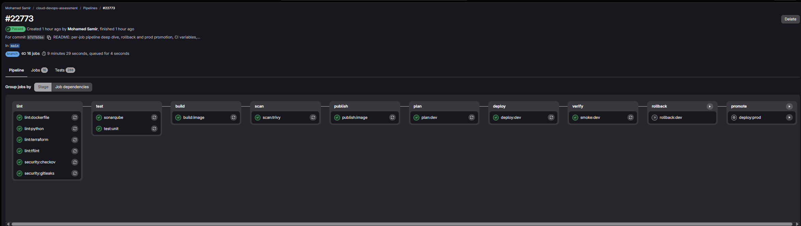](docs/evidence/01-pipeline.png)

**02 · tests**: `test` stage: unit tests and the SonarQube job passed.

[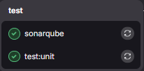](docs/evidence/02-tests.png)

**03 · sonarqube**: SonarQube **quality gate: Passed**. 0 new issues, 0 security hotspots (rating A).

[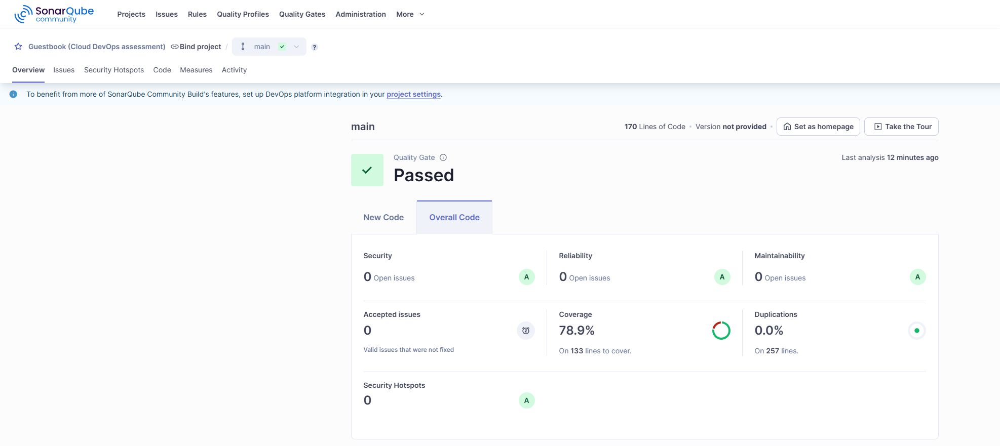](docs/evidence/03-sonarqube.png)

**04 · trivy**: `scan:trivy`: clean, no fixable HIGH/CRITICAL vulnerabilities. Report uploaded to GitLab container scanning.

[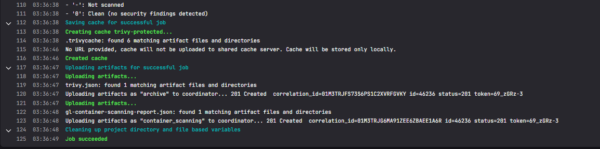](docs/evidence/04-trivy.png)

**05 · terraform apply**: `deploy:dev`: `terraform apply tfplan` → rolling ECS update → wait for steady state → S3 sync → CloudFront invalidation. Outputs include the app URL.

[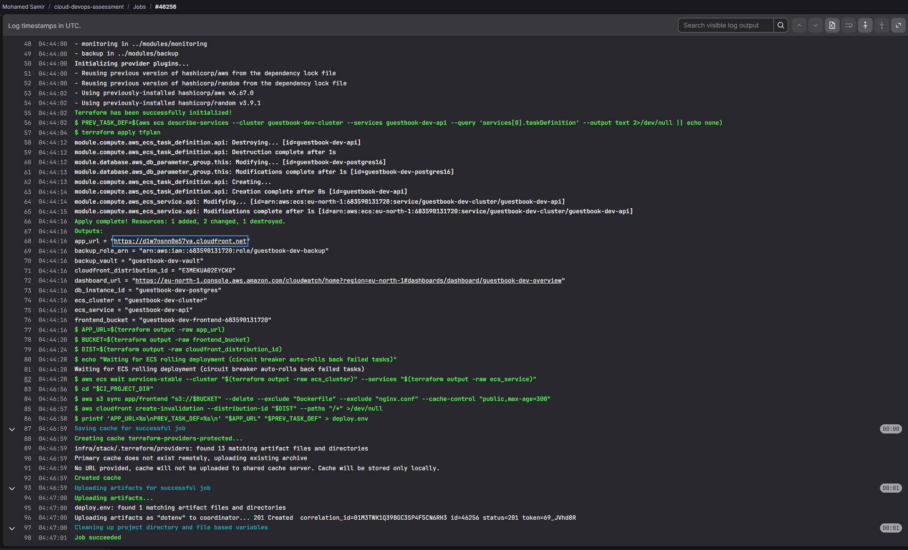](docs/evidence/05-terraform-apply.png)

### Application

**06 · app**: The live app through CloudFront. The status line shows the **deployed commit (`d0c29b69`)** and **database up**. Messages include ones written by the pipeline's smoke tests.

[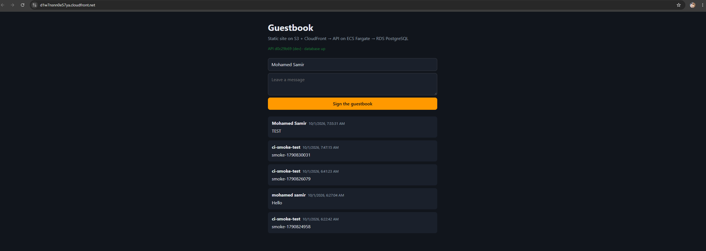](docs/evidence/06-app.png)

### AWS resources

**07a · ecs**: ECS service `guestbook-dev-api`: Active, deployment **Success**, ALB target **Healthy**, health-check grace period 30 s.

[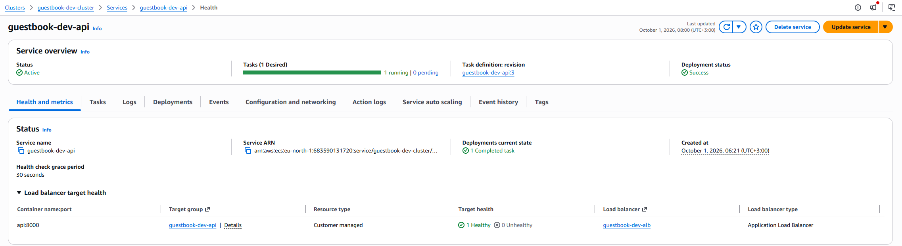](docs/evidence/07a-ecs.png)

**07b · alb**: ALB **Scheme: Internal**, spread over 2 AZs. Listener default action **403 Forbidden**, with forwarding only by the `X-Origin-Verify` rule.

[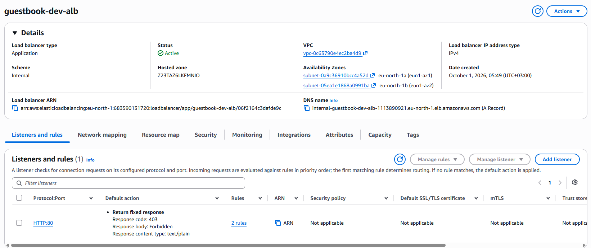](docs/evidence/07b-alb.png)

**07c · rds**: RDS `db.t4g.micro` PostgreSQL. **Internet access gateway: Disabled**, **IAM authentication: Enabled**, master credentials in **Secrets Manager**.

[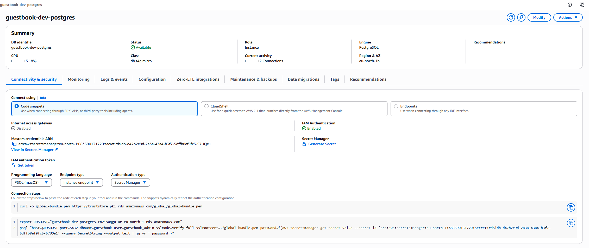](docs/evidence/07c-rds.png)

**07d · secret**: The DB secret is **created and managed by RDS** and encrypted with the customer-managed key **guestbook-dev-main**.

[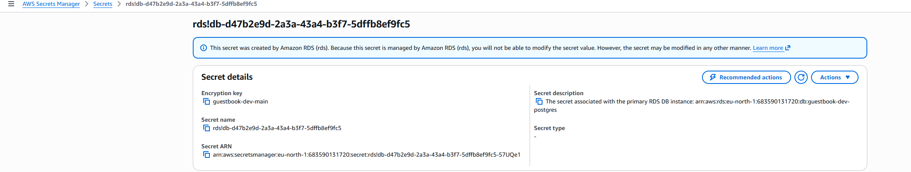](docs/evidence/07d-secret.png)

**07e · cloudfront**: CloudFront origins: `alb-api` is a **VPC origin** (internal ALB), and `s3-frontend` uses **Origin Access Control**.

[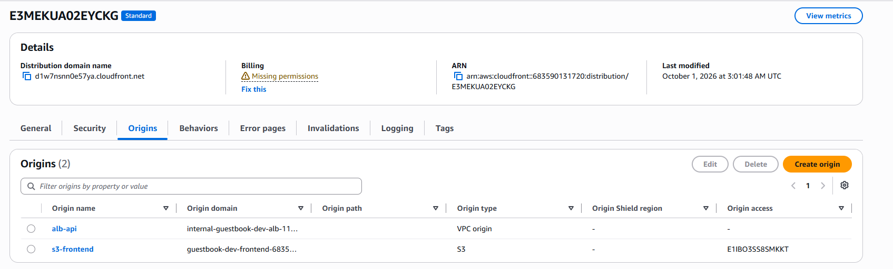](docs/evidence/07e-cloudfront.png)

### Monitoring & alerting

**08 · dashboard**: Dashboard `guestbook-dev-overview` (Terraform-defined): requests, 5xx, latency p50/p95, healthy tasks, ECS CPU/memory, app error logs, RDS CPU/connections, and 7 alarms all OK.

[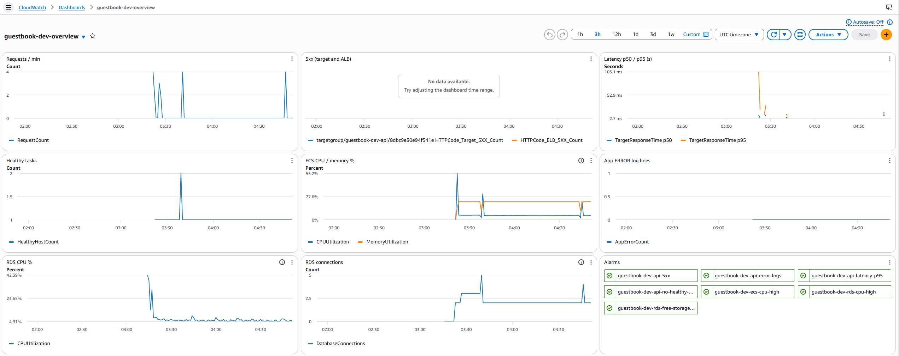](docs/evidence/08-dashboard.png)

**09 · alarm email**: Alarm notification **delivered by email** via the KMS-encrypted SNS topic: `guestbook-dev-api-5xx` OK → ALARM, with threshold, metric and dimensions.

[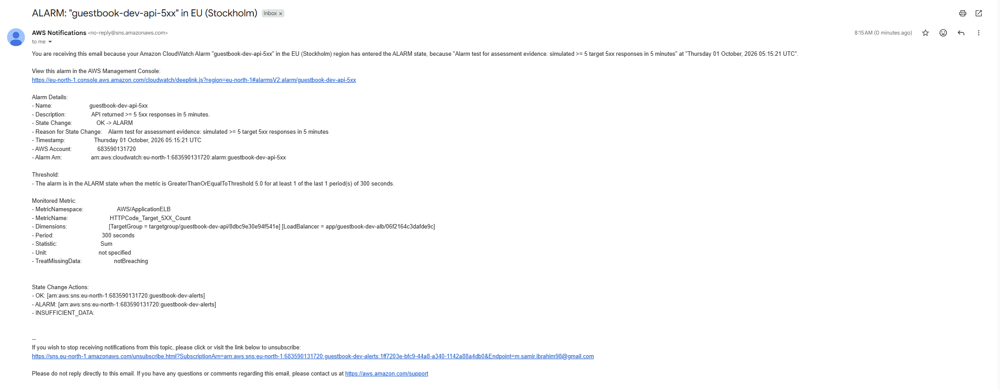](docs/evidence/09-alarm-email.png)

### Load test & autoscaling

**10a · dashboard load**: *Healthy tasks* jumps **1 → 3** during the k6 load test.

[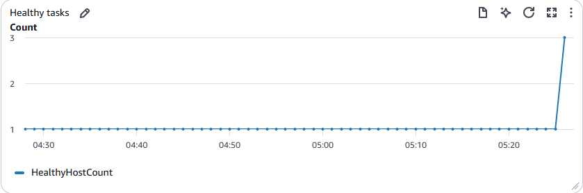](docs/evidence/10a-dashboard-load.png)

**10b · ecs tasks**: Cluster view: **3 tasks running**. Two new tasks started about 41 s earlier, alongside the original.

[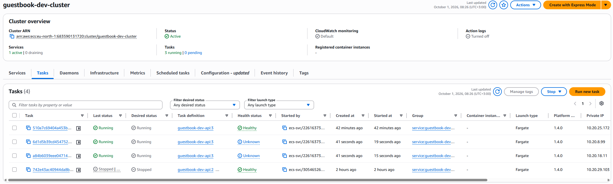](docs/evidence/10b-ecs-tasks.png)

**10c · scaling event**: Service events: *"Successfully set desired count to 3 … Cause: monitor alarm TargetTracking-…-AlarmHigh in state ALARM triggered policy guestbook-dev-api-requests"*, then 2 tasks started, 2 targets registered and steady state reached.

[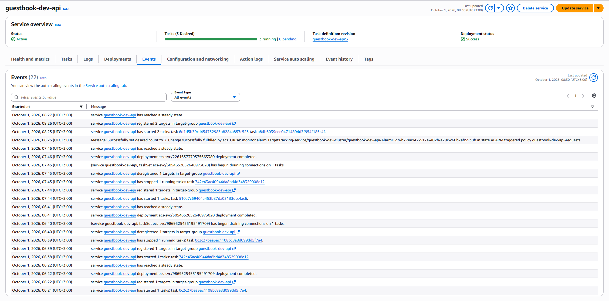](docs/evidence/10c-scaling-event.png)

### Not included

| # | Item | Why |
|:-:|---|---|
| 11 | Restore drill | Script provided ([`scripts/restore-drill.sh`](scripts/restore-drill.sh)), not run for this submission |

<div align="center">
<br/>
<sub>Built by <b>Mohamed Samir</b> · Cloud / DevOps Engineer assessment</sub>
</div>
